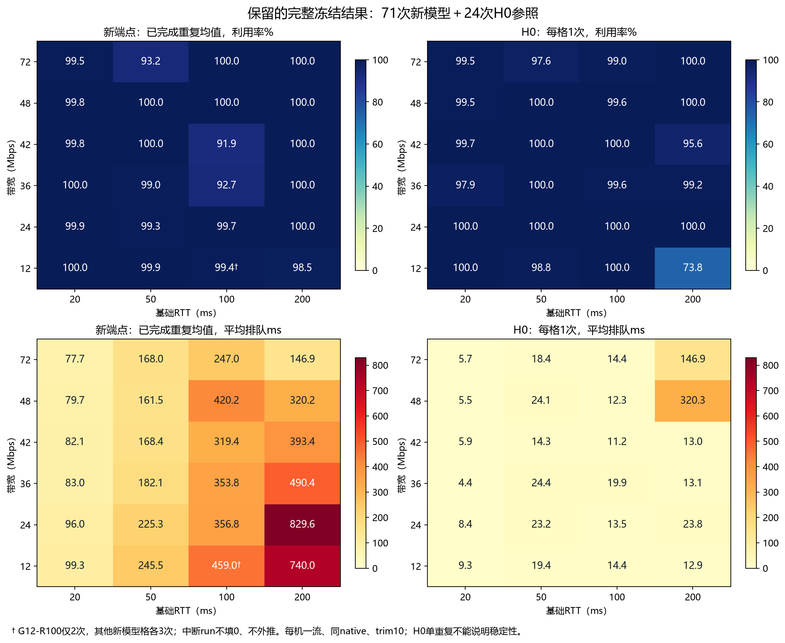
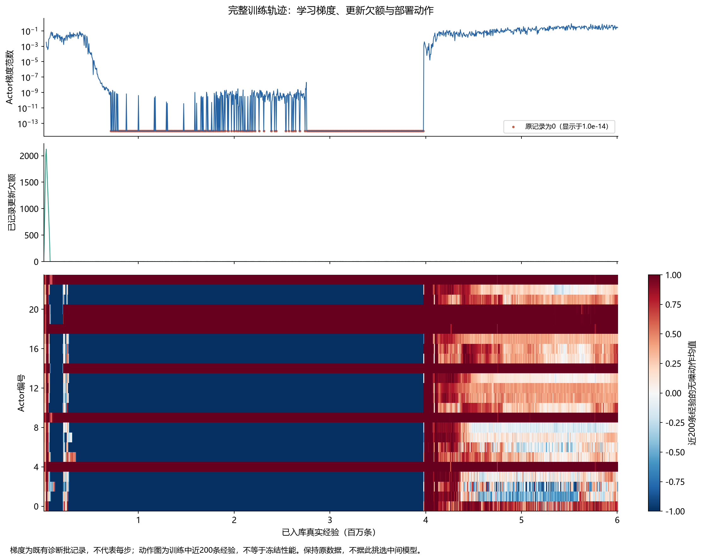
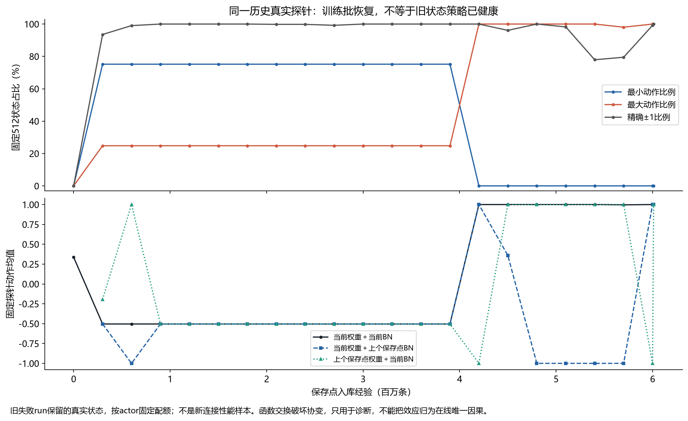
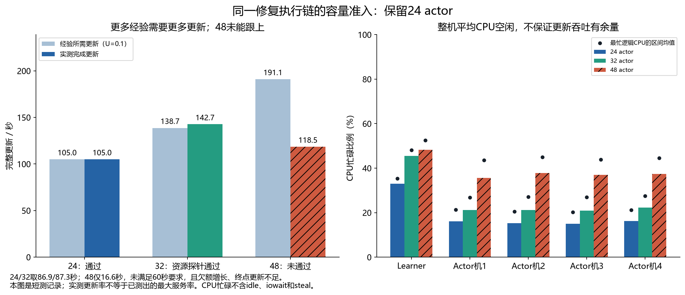
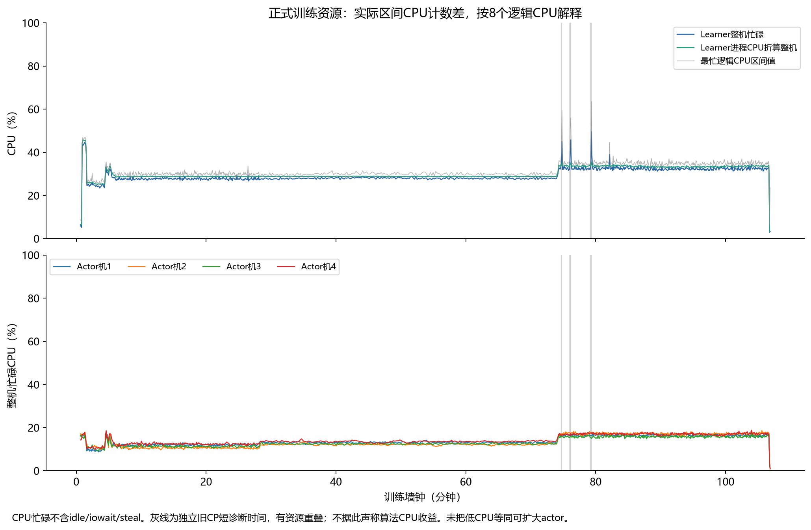

# 600万样本修复重训：结果、异常和下一步

2026-11-12。训练执行完成，冻结计划95/96次完整完成，最后1次中断。原始72次新模型确认评分为INCOMPLETE_OR_EXECUTION_FAILED，但已有23个完整三重复条件全部排队失败，且全量排队均值的保守下界274.68ms远超20ms门槛，故端点已确定不能通过健康验收。五机最终终检通过。恢复开机后只取证/收尾，没有追加训练或评测，也没有续原240分钟窗口。

## 已完成什么

运行代码为`667533e547ee66ec10b2e7193f06548bdf3790c6`，后来的报告提交不是运行代码。随机seed3、1 learner＋24 actor、原24条件，从零初始化，61个共同模型/BN张量与原seed3相同。最终6,010,470条真实入库经验；599,818次完整critic迭代、actor和target更新，1,199,636次critic优化器操作；计数器1,799,454，等于完整迭代的3倍。24路生成、入队、入库相等，动作映射错误0，训练进程正常退出，五机训练后归属检查通过。训练约107.4分钟。

选定端点为`@RUN_ROOT@/frameworks/baseline/checkpoints/repaired-base-seed3-6m/step-6010470`。22个保存点只作离线诊断，未挑选中间点替代最终验收。12张量policy经VPC分发并核对SHA，不代表本机已下载新模型或完整replay。

最终评测预登记为新模型24格×3次，加H0每格1次，共96次；每机同时仅一流，同一native，模型冻结、优化和探索均为0。最终保留新模型71次、H0全部24次完整结果，95次完整项0执行错误。新模型G12-R100第二重复只有34.494秒down.log、无最终result，单独保留中断证据，不填零、不外推、不补跑；该格另两次有效。原健康评分器保持不变，对71/72返回INCOMPLETE_OR_EXECUTION_FAILED。

[训练账本](../evidence/baseline-capacity-repair-20261112/training-complete.json) · [复算结果](../evidence/baseline-capacity-repair-20261112/training-diagnosis.json) · [原健康登记](../evidence/baseline-capacity-repair-20261112/health-registration.json)

## 冻结性能：主要失败是高排队和丢包

|模型与口径|利用率|平均排队|P95条件等权|丢包|
|---|---:|---:|---:|---:|
|新端点：各条件已完成重复均值，再24格等权|98.857%|281.058ms|337.007ms|15.530%|
|H0：24格各一次|98.328%|32.437ms|43.750ms|0%|

新模型不是计划72次齐全的估计：G12-R100为2次、其余23格3次；H0单次也不支持稳定性或修复因果比较。已完成新模型所有run的最低利用率91.78%，没有低于50%的灾难run。23个三重复条件利用率和尾段利用率均过门，但mean和P95排队全部失败；16格trim丢包失败、15格接管后丢包失败。失败形态由之前部分连接低吞吐，转为持续过度排队，不能据吞吐接近满载称健康。

最弱排队格G24-R200为829.65ms、G12-R200为740.03ms；R20六格平均排队86.30ms、丢包26.57%。这与窗口控制过于激进相容，尚不能仅凭结果定位为BN、Q或探索中的唯一因素。历史512状态全+1也不能代替这71条新连接的实际动作序列。

缺失run不会逆转结论：71条有效queue之和除以预定72，已经274.684ms；任何非负的缺失run排队只会使该全量均值更高。此处只做数学下界，**没有把中断run虚构为零排队样本**。因此正式确认执行仍标INCOMPLETE，工程结论明确为不接受此端点作健康基座，也不再为凑齐次数补测。

[95次原始汇总](../evidence/baseline-capacity-repair-20261112/frozen-final-latest.json) · [原评分器结果](../evidence/baseline-capacity-repair-20261112/health-assessment.json) · [已观测失败与下界](../evidence/baseline-capacity-repair-20261112/observed-performance-assessment.json) · [逐格CSV](../evidence/baseline-capacity-repair-20261112/available-condition-metrics.csv) · [中断证据](../evidence/baseline-capacity-repair-20261112/interrupted-run-evidence.json)

## 训练过程的异常意味着什么

1,281行训练记录中1,271行actor梯度可用，543行精确为0。首次百万样本后梯度重新超过.001的既有记录在3,980,799条；较疏的actor状态监测到约4,205,000条时才明确记录不再有接近全最小动作的actor。两种采样频率不同，不把420万说成精确恢复起点。终点记录梯度.23477，但这只说明当前诊断批存在梯度，不说明部署性能健康。

更新额度基本跟得上：10万以后既有记录最大欠额2.9，FIFO最大17，最终完成`floor((6,010,470−12,288)×.1)=599,818`次，无整数更新欠额。监测最后显示.2是公式的小数余量，不是少做一次更新。每actor真实经验132,439—288,423条；回放采样各约12,796,118行、贡献差1。**采样均衡不等于各条件的新经验一样多，更不等于状态多样性充分。**

512条固定历史真实状态与当前训练批表现不同：晚期训练批有梯度，历史探针的最终动作却全为+1。权重和BN统计交换常引起符号切换，支持分布/统计协变值得查，但交换破坏协变，不能当作在线因果证据，也不能把历史探针称为新连接评测。

完整6,010,470行行为日志中95.1831%的无噪动作绝对值≥.99，84.2359%精确等于±1。近下界状态仅1次加噪后动作变正，上界状态0次变负；按实际policy值和不衰减σ=.2高斯计算，合计期望1.644次。故“仍在加噪”并不等于“边界两侧都有有效探索”。这不是TCP逃逸概率；状态、内核、BN和共享参数仍可使策略恢复。

native请求上限2³¹−1共2,173,263次，其中2,153,768次是窗口已到上限且倍率≥1，均满足实际clamp公式。这说明不同正动作可能映射为同一窗口请求，弱化局部动作辨识；不是发现了2,173,263次整数溢出，也不等于同样多的真实在途包。

## 修复范围与开源实现差异

本轮保持70维状态/单cwnd动作/20ms、raw Orca奖励、MSE、150k replay、actor均衡采样、U=.1、单连接、不衰减Gaussian以及在线BN。目标BN修复相对上一轮保持开启；新增双critic独立Adam、唯一名称target配对和listener CLOEXEC。独立Adam使固定step0重复更新从7种结果变为1种，但也改变早期偏置校正；晚期旧模型已无该差异。重复target合成检查实际表现单tau，不宣称修了已证双tau。

本项目是Canopy Sonnet网络加raw Orca目标的工程训练路径，不是完整Canopy性质训练或原Orca逐字节重现。官方名义256条件×50k约12.8M，本轮约46.96%总量；但24个现有条件每格真实经验已经更多，增加现有条件重复次数不能补足官方训练分布的覆盖差异。仍不能宣称6M足以收敛或完整复现。

[作者TD3代码](https://github.com/sfujim/TD3/blob/master/TD3.py)用两个Q损失求和、一次optimizer step，默认延迟actor；其Actor无BN。因此共享优化器本身并非错误，两次并行更新共享TF时钟才是本次直接证据。[Spinning Up TD3](https://spinningup.openai.com/en/latest/algorithms/td3.html)区分全范围初期随机动作、优化热身及后续Gaussian。当前覆盖热身没有实现前者，actor/critic为1:1；这些是可以单独检验的差异，不是照搬默认参数的理由。

在线BN另有独立缺陷：实际保存图4个moving变量各有2个未加锁写入。固定旧模型重复24次，当前并行方式5种统计结果，部署动作差约.0032；“先全部BN再actor”仍9种；“每统计一个写入再actor”完全一致。**缺失的关键控制是“只去重，保持并行”**，未验证排序是否独立必要；候选没有加入本轮长训。[CrossQ](https://arxiv.org/html/1902.05605v4)提供off-policy统计设计的研究参照，但改成CrossQ、去target或换归一化都属于新算法实验。

## 为什么不直接扩大集群或再长训

24容量通过；32资源探针通过但仅重复前8条件，会改训练分布；48欠额增长72.69次/秒，240k端点少8,302次完整更新且有效稳态仅16.61秒，未准入。48进程COMPLETED不能当容量PASS。正式因此保留24，不靠降低U放行。

整机利用率低不能推出更新服务率足够。正式训练无持续积压，也不能把后续性能弱归因算力不足。本轮确实在约400万后出现梯度恢复，证明早停可能漏掉恢复阶段；同时旧探针仍强饱和，说明更久本身不构成健康保证。一轮曾训好支持“该工程规模能产生有用模型”，不证明其稳定成功率。训练轨迹随机、新连接敏感和验收标准变化需要分别讨论。

## 下一步的可证伪顺序

1. 本轮以95完整、1中断收尾，原始结果保留；端点不接受为基座。下一轮先补执行/学习短诊断，不原样追加更久训练。
2. 在下一次允许的短诊断中，先补在线BN“唯一写入并行”控制；同CP、同512状态、同优化器现场重复24次，同时记录每个变量、部署动作、调用次序和EMA预期值。再以多个保存点验证，不能仅凭一次确定性声称性能根治。
3. 明确BN候选契约后，比较归档H0与失败端点在启动/稳态保留状态上的actor logits、Q动作曲线、tanh导数、真实行为动作支持和clamp别名。离线Q偏好不等于真实网络因果收益。
4. 再登记最小单变量学习：执行修复优先；探索范围、actor延迟和重连分别改变学习/数据机制，不能全塞入同一“修复”后解释唯一因果。仍保留足够训练预算、最终冻结验收和H0同期参考。
5. 基座通过后再第二seed和独立双动作分支。当前不把目标转成调reward迎合门槛，也不拿CPU低作为加机器依据。

新BN证据的Claude窗口交流被Esc中止，尚未送达；[已完成的此前五点讨论](../evidence/baseline-capacity-repair-20261112/claude-review.md)保留。新的完整审阅材料另列请求，不声称已达成新共识。

## 复算与存储范围

`python tools/analyze_baseline_repair_6m.py evidence/baseline-capacity-repair-20261112`复算训练与完整行为日志汇总；2.26MB压缩分析输入来自已有小证据传输，含进程/逐核计数与状态摘要，不含逐包日志、模型tensor或replay。`python tools/analyze_baseline_frozen_6m.py evidence/baseline-capacity-repair-20261112`复算71条新模型/24条H0与缺失run下界；`plot_baseline_frozen_6m.py`重绘保留网格。原始计划和中断均保留，不把95条标成96条。

重新开机后五机最终只读终检均PASS：本轮活进程/已登记IPC/相关监听均0，51个旧模型、旧core/sysctl/查询过的旧CP与replay未变，当前formal清单和native未变。终检发生在重启后，不能据此声称关机前曾完成正常收尾。仅额外复制343558字节的12张量负面端点策略供复核，见evidence下negative-final-policy与传输SHA；不作为健康基座，不覆盖H0。其余大checkpoint、replay及逐包原始日志仍云端。无完整TCP/history/max_bw/actor随机现场resume加载器，载权重不称无缝恢复。
