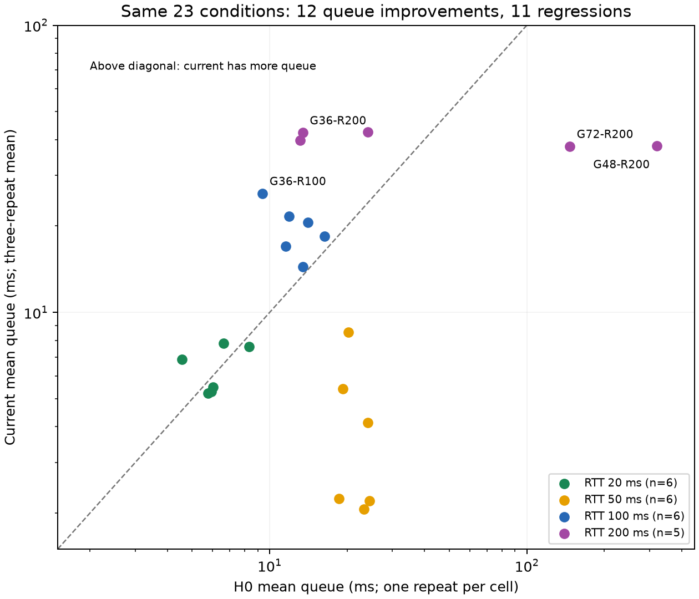
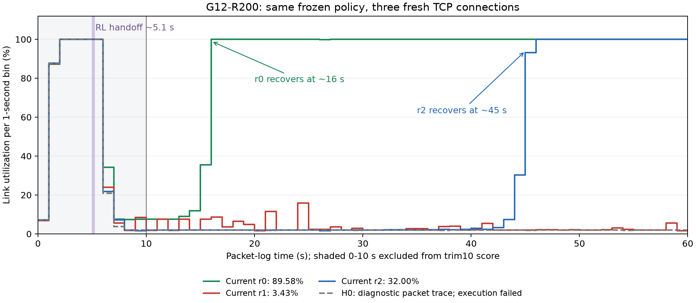

# 当前候选与最初基线：性能已经接近可用，差异集中在恢复稳定性

2026-11-12，仅重算本机已有证据，0云端连接、0新TCP、0TF或优化。原健康FAIL、H0执行错误和冻结模型均不变。[可复算JSON](../evidence/baseline-comparison-20261112/analysis.json)由[离线工具](../tools/analyze_baseline_candidate_comparison.py)生成，含逐格、逐秒、来源SHA和重建检查。

## 1. 当前模型值得保留，FAIL不能理解为整体表现很差

当前是在线BN去重后从随机seed3训练6013196经验的唯一终点step-6013196。“最初基线”指2026-10-10冻结的H0、step-2412694，非作者发布的Orca/Canopy权重。两模型都保存；H0不是现行逐格健康门全部通过的证明。

|口径|模型|条件及重复|利用率|mean queue|P95条件等权|
|---|---|---|---:|---:|---:|
|原归档历史评测，trim10|H0|24×3|97.748%|32.323ms|43.417ms|
|本轮冻结，trim10|当前|24×3|96.814%|16.788ms|23.083ms|
|本轮相同有效条件，trim10|H0|23×1|99.256%|33.117ms|44.130ms|
|本轮相同有效条件，trim10|当前|23×3|99.212%|16.584ms|22.464ms|

trim10是包日志0—60秒中的10—60秒。先每条件重复均值，再条件等权；P95是每run分位数的条件等权描述，不是池化全部包的全局P95。历史活动日期/执行链不同，前两行不能当严格同期因果比较；最可比的是后两行，但H0每格仅一次，不能据此比较方差或训练成功率。

在本轮可比23格上，当前吞吐仅少0.044个百分点，mean queue降低49.92%、P95条件等权降低49.10%。它已具备很好的主体控制能力，值得冻结作为主要候选继续核查；没有理由丢掉模型重新从头摸索。

保留启动的完整0—60秒口径也有改善：同23格当前97.756%利用率/24.427ms排队，H0 98.068%/39.968ms。当前全24格完整0—60秒为95.503%/33.319ms，不能把trim10的16.788ms说成包含启动的全程排队。各窗口统计都保留在JSON，不改变原验收口径。

同时，它没有逐格支配H0：**12格平均排队改善、11格变差**。H0的G48-R200从320.078ms降到37.965ms、G72-R200从147.004ms降到37.876ms，贡献了很大一部分总体收益。仅作敏感性描述，去掉这两格后的同21格mean queue为当前14.552ms、H0 14.029ms；原验收并未删格，当前完整分数和FAIL不变。

|相同条件按基础RTT分组|格数|H0 mean queue|当前mean queue|H0利用率|当前利用率|
|---|---:|---:|---:|---:|---:|
|20ms|6|6.207ms|6.383ms|99.620%|99.983%|
|50ms|6|21.657ms|4.103ms|99.083%|98.336%|
|100ms|6|12.789ms|19.681ms|99.443%|98.659%|
|200ms，缺G12-R200|5|103.557ms|40.085ms|98.802%|99.999%|

因此，当前修掉了旧模型两处严重高队列，50ms组也显著低队列；100ms组和部分200ms条件排队仍有改进空间。不能只用“平均减半”替代逐条件分析。

当前24格中23格通过原登记门；那23格69次里68次利用率超过97%，另一次G12-R100为77.165%、随后末10秒已满载。整体性能已经很接近工程目标。健康门之所以仍FAIL，是同一弱格有两次利用率低于50%，不是总体利用率/总体排队不合格。旧H0按原来的“总体接近作者Orca”冻结，若用今天的严格门，历史32.323ms总体排队及320ms单格排队也不满足要求；不能因为旧模型叫baseline，就认定旧模型更健康。

## 2. 三次相差大，具体差在恢复时间

以下全部使用同一份当前模型，评测无训练、无探索，模型前后SHA相同，不是三个训练seed。三个run同trace哈希、12Mbps、基础RTT200ms、1000包队列；各机最多一流。

|当前重复|主机slot|RL接管时刻，包时钟|第一RL动作前cwnd|首10秒丢包率|trim10利用率|trim10排队|恢复至持续≥90%|末10秒利用率|
|---|---:|---:|---:|---:|---:|---:|---|---:|
|r0|2|5.039s|3,575,421|22.20%|89.577%|36.011ms|约第16秒|约100%|
|r1|2|5.163s|3,575,421|19.22%|3.426%|5.491ms|60秒内未恢复|2.457%|
|r2|1|5.148s|3,843,302|20.49%|32.002%|22.944ms|约第45秒|约100%|

恢复时刻从已保存的1秒出包/容量计数计算：只在第10秒后寻找连续5个1秒区间利用率均≥90%的最早位置；本次r0/r2此后到第60秒也一直满足。精度是1秒，不能解释成原始逐包的精确事件时间；r1只表明观察窗口内未恢复，不能推出永久无法恢复。

|包日志时间段|r0利用率|r1利用率|r2利用率|
|---|---:|---:|---:|
|0—10秒|55.08%|53.41%|52.75%|
|10—20秒|47.89%|5.21%|2.01%|
|20—30秒|99.99%|4.60%|1.97%|
|30—40秒|100.00%|2.51%|2.12%|
|40—50秒|100.00%|2.36%|53.92%|
|50—60秒|100.00%|2.46%|100.00%|

这更准确地说明“恢复速度对状态历史敏感”：r0能够较快离开低窗区，r2经历约几十秒低窗后离开，r1在60秒内未离开。r0与r1还是同一台主机、同样首窗，单纯“某台服务器性能差”或“首窗大小唯一决定结果”都不能解释它们的全部差别。

## 3. 是否测试出了问题：算分没有发现错误，启动执行链有明确异常

已完成的离线核查：

- 利用率来源是实际包日志出队字节/trace服务容量，不依赖RL的max_bw估计。四条弱日志的full、startup0_10和trim10利用率均从60个1秒计数独立重建，误差小于1e-12。
- 三个当前run的包日志均覆盖完整60秒，末记录分别62.965/64.119/62.045秒，没有把半段日志除以60秒。后续多出的记录不计入固定评分窗口。
- 首native控制时间由日志init/base时钟重建，与原评测记录的接管时刻相符。CSV elapsed_s从RL接管后开始，比包时钟晚约5.1秒；分析中二者分开，不能直接拿同名“第10秒”叠图。
- 三次第一动作均为25%最大减窗，首窗数百万已经在RL首次动作前存在。不是新权重第一步主动放大窗口，也不是三次用了不同模型或探索噪声。
- 控制ID/返回码检查通过。坏run控制间隔P95约184ms、r2约182ms，r0约21.7ms；低窗、RTT200ms时反馈变稀疏与此相符。它不能单独证明CPU不足或IPC故障，20ms是轮询/目标节拍，不保证每20ms都有新ACK统计。

这些核查反对“只是利用率公式、计时单位或漏采造成3%假象”的解释，但尚未在本机重新读取全部原始包/15字段、核对定制内核，不能宣称排除了所有测试问题。

最具体的异常是原native的启动辅助：在首个策略状态之前，只要有有效RTT反馈且`ssthresh<cwnd`尚未成立，就在20ms节拍内写1.1倍cwnd。它具有`avg_urtt>0`外层反馈门，不能称完全不受ACK约束；但增长倍率没有按ACK数或RTT归一化，200ms一个RTT可经历多个写窗机会。三次接管前约5秒期间发生窗口放大，随后首10秒均有约19%—22%丢包和552—591ms排队。这里的丢包率是该窗口drops/arrivals；大cwnd仍只是窗口上限，不能当作实际发出了数百万在途包。

按trace的1504字节等效包，12Mbps×200ms的BDP约200包，队列约1000包、约1秒服务时长。cwnd数百万远大于这个尺度；恢复阶段窗口只剩约4包，则`4×1504×8/0.2`约0.24Mbps，即12Mbps的2%。这与坏连接1秒计数里的约2%吞吐相符。**真实低窗和真实低出包量是互相吻合的，不能仅通过改统计公式消掉。**该近似忽略MSS、重传、ACK和排队，不是实际packets_out测量。

本轮同条件的旧H0也出现类似轨迹：接管前3,843,302包，首10秒20.84%丢包，随后包日志trim10约1.958%利用率、窗口约3包。它在842条有效状态后触发15秒无反馈watchdog，正式状态仍EXECUTION_ERROR，这条包日志仅作诊断，不补成正式第24格。低吞吐发生在watchdog之前，不能把它全部解释为末尾报错。它支持共享启动/恢复压力值得优先查，而不证明新模型的恢复策略毫无问题。旧H0历史G12-R200三次也只有65.22%/61.32%/98.76%，这个条件原本就有连接间波动。

## 4. 为什么相同权重会走向三个结果

相同带宽/RTT参数和相同seed不等于相同TCP现场。建连时序、ACK聚合、丢包/重传现场、初始RTT和带宽峰值、十帧状态历史都会随真实执行变化；同一个确定性策略接到不同历史，就会给不同动作，动作又反过来影响后续反馈。

已有分段状态显示：r0在RL接管后10—20秒平均cwnd约334，20—40秒约350；r2在接管后5—20秒平均cwnd精确约4，之后才恢复；r1在接管后20—40秒平均约4.21、40—60秒约3.74，动作均值仍明显为负。这是策略/内核闭环中的不同恢复轨迹。区间均值不是逐时刻策略，也不能拿它确认RTO机制；缺少逐条原始在途、重传和Q信息，尚不能唯一归因于RTO、critic或某一个状态分量。

上述最后一个RL区间只统计实际有效反馈，约在接管后55秒结束，不把它外推到完整60秒。启动辅助也是训练/评测共用执行链；长训练连接通常只经历一次启动，回放后期会淘汰它，训练还带探索噪声，而部署评测使用新连接、关闭探索。因此它可能同时暴露执行链压力和策略恢复覆盖不足，不能简单归为“测试脚本坏了，模型其实完全稳定”。

坏run的max_bw后期约1.474MB/s，接近trace容量1.499MB/s；r2约1.495MB/s，恢复较快的r0约1.549MB/s。因此本次没有“max_bw低估成容量的几十分之一、让策略误以为满载”的证据。几%的归一化差异仍可能影响策略，但尚未受控验证。单连接训练、150k回放淘汰启动历史是另一个已知覆盖缺口，不能用这三次评测直接证明补重连必然解决。

当前只能把机制排序为：**先查共同启动冲量及其与策略低窗恢复的耦合；再按原始状态判断重连覆盖、动作/整数窗口映射和critic支持。**三次重复不是三个训练模型，不能拿这三次估计训练成功率，也不能因此要求再训更长。

## 5. 验收标签与下一步

当前完全可以称为“主体性能已到位、值得保留的基座候选”。原FAIL仅提醒仍存在特定新连接灾难恢复风险，不否认大多数条件表现好。若只把G12-R200的条件平均利用率从41.67%提高至90%，且其他23格不变，总体利用率的代数结果约98.83%；提高至100%则约99.24%。这是敏感性计算，不是修复后的预测，延迟也可能变化。

下一步已准备的[40次同权重启动配对筛查](BASELINE_STARTUP_NEXT_20261112.md)比直接长训更能回答当前问题。它改变整个前置启动协议，保留同模型和接管后控制逻辑；必须预先对齐从建连开始的包时钟、首有效反馈和接管时刻，避免靠提前截断启动成本“变好”。阳性后独立完整确认，并保留旧FAIL。若正常启动已稳定通过，就可以在明确执行契约下复用当前模型，再安排必要的第二训练seed；无需为了修一次测试启动先重新学习全部窗口能力。

延长单次测试可作为额外诊断，但不能用“跑到恢复才结束”替代固定60秒；r0/r2最终满载不等于r1已知也会恢复。当前不因疑似测试问题而删掉弱格、只报末10秒或追溯放宽门槛。后续新云端实验仍需新的明确窗口，本次全部分析和制图已在本机完成。

复算：`python -B tools/analyze_baseline_candidate_comparison.py --output /new/output`；加`--plot`需要Matplotlib，仅用于画图。大checkpoint、replay、逐包日志没有重复下载；本文只使用已有汇总、旧CSV和8-run摘要中的4条G12-R200记录。
