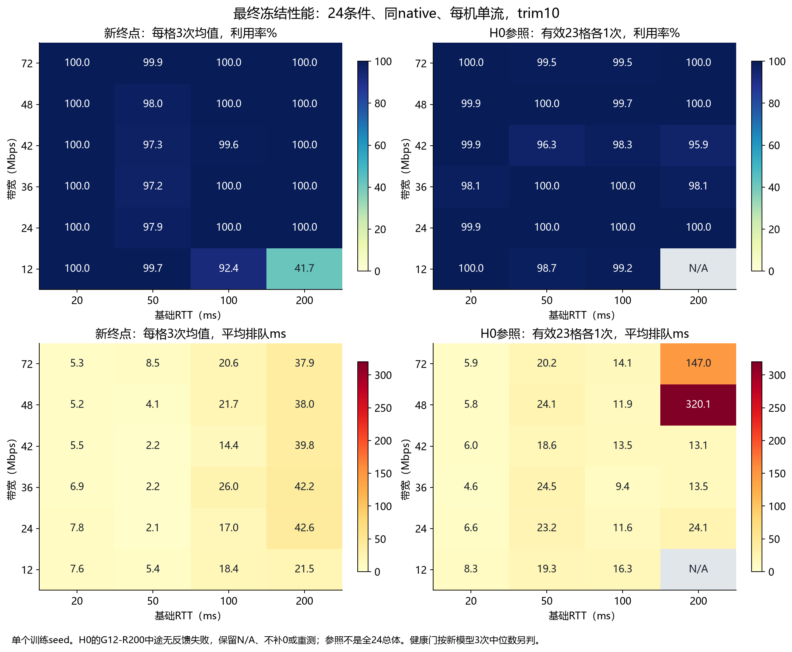
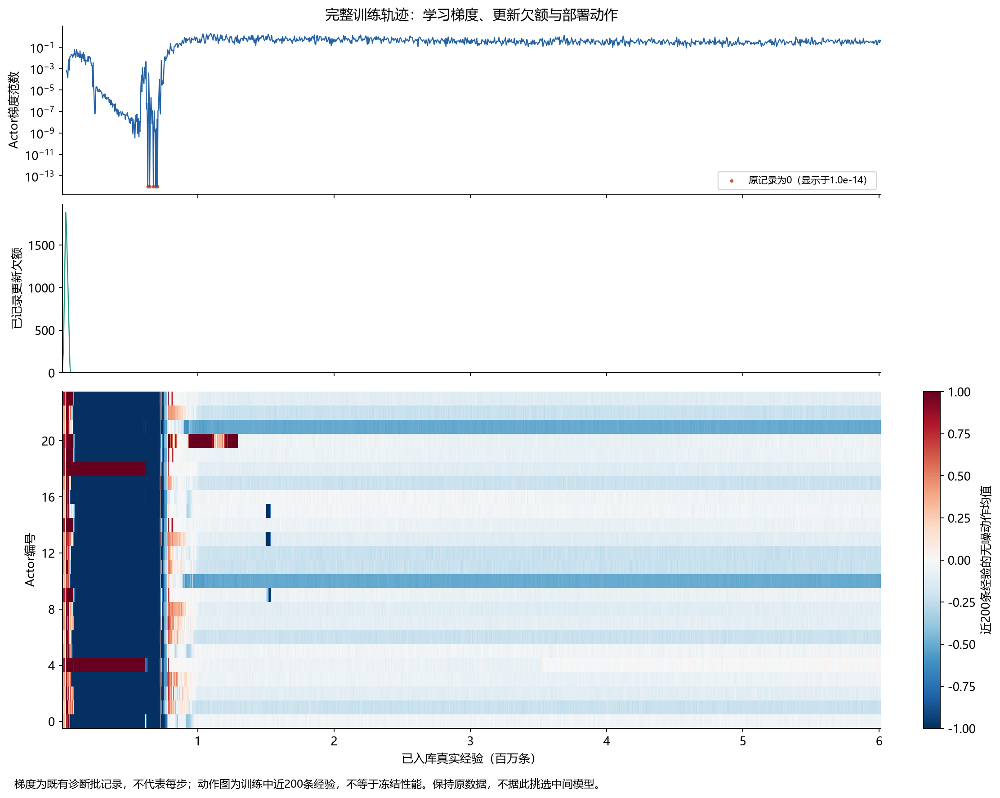
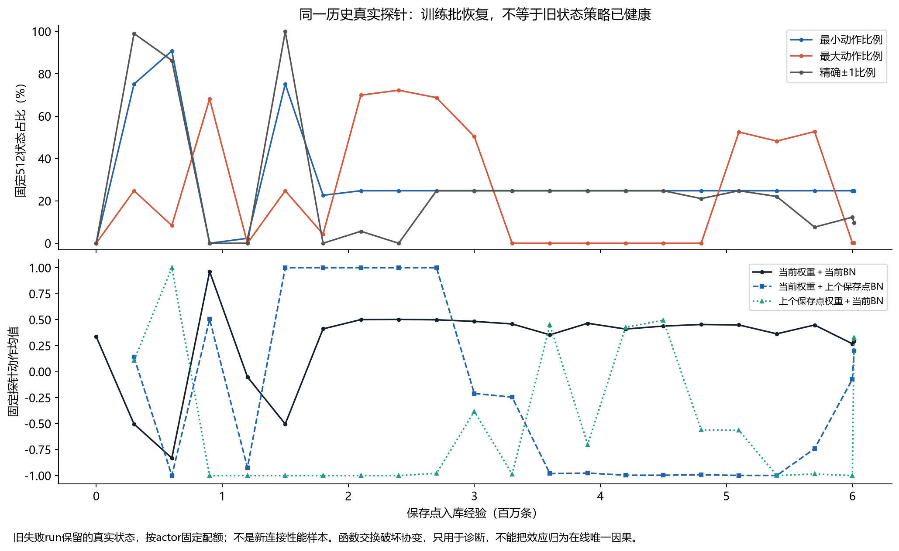

# 在线BN修复重训与完整冻结验收：FAIL

2026-11-12。本轮未训出符合登记门槛的健康基座，不覆盖原H0，不选择中间checkpoint改写结论。

1 learner＋24 actor，四台actor机各6个原训练条件。双learner提案已取消。本轮仅一次fresh seed3名义600万训练；96次原冻结任务全部执行结束，其中95次完成，1次执行失败，0重试。新模型72次全部完成；H0参照有效23/24。五机最终归属/已登记IPC/监听均为0，原51模型、旧源码/sysctl及旧诊断checkpoint/replay校验不变。后续没有追加学习。

## 最终结果

trim10先对每条件重复取均值，再24条件等权；逐格健康检查使用3次中位数，灾难门检查每次有效run。

|模型及范围|利用率|mean queue|P95条件等权|drop|
|---|---:|---:|---:|---:|
|新终点，24条件×3次|96.81404%|16.78794ms|23.08333ms|0.00000%|
|上轮重复在线BN写的负面终点，仅71个已完成run|98.85704%|281.05832ms|337.00694ms|15.53001%|

新模型逐格失败数1/24；灾难run标志True。所有72次中最低利用率3.426%，最大单run mean queue 42.751ms。上一轮有1次中断，不当作同等重复数或多seed因果证据。

同期H0只在以下相同有效条件集合内描述比较，不把缺失run填0：

|同一23条件集合|利用率|mean queue|P95条件等权|drop|
|---|---:|---:|---:|---:|
|新模型，每格3次|99.21167%|16.58384ms|22.46377ms|0.00000%|
|H0，每格1次|99.25594%|33.11733ms|44.13043ms|0.00000%|

H0-reference-c03（G12-R200）在842个有效状态后连续15秒无新状态失败，模型未变、优化/探索0、归属资源已退出。它不符合事前“零有效状态”重试资格，故不补测；原H0评分保留INCOMPLETE_REFERENCE，不声称全24参照完成。失败本身不能定位为H0策略、TCP或测量端的唯一问题。这里的相同23条件数值是描述性补充，不是新模型完整24条件健康评分的替代，也不支持H0稳定性或CPU因果结论。



排队较高的六格如下，均为三次中位数；这是弱项描述，不是事后改变门槛。

|条件|利用率|mean queue ms|P95 ms|drop|原门槛|
|---|---:|---:|---:|---:|---|
|G24-R200|100.00%|42.74|54.00|0.000%|通过|
|G36-R200|100.00%|42.23|53.00|0.000%|通过|
|G42-R200|100.00%|39.99|51.00|0.000%|通过|
|G48-R200|100.00%|38.09|50.00|0.000%|通过|
|G72-R200|100.00%|37.99|52.00|0.000%|通过|
|G36-R100|100.00%|26.49|35.00|0.000%|通过|

原门保持：每格利用率≥90%，mean queue≤0.25×基础RTT+10ms，P95≤0.5×基础RTT+20ms，trim drop≤1%，末10秒利用率≥85%，接管后drop≤5%，任何有效run利用率不得<50%；总体利用率≥95%且mean queue≤20ms。没有按结果放宽门或按分数补测。

## 唯一失败格：先区分启动执行链与策略恢复

G12-R200三次利用率89.5769%/3.4264%/32.0021%，后10秒分别约100%/2.457%/100%。两次最终恢复到满载，一次仍低窗口。G12-R100另有一次77.1651%，该格三次中位数仍过门；不能把逐格PASS说成每条新连接都完全稳定。

训练/冻结全部结束后，只读汇总8个既有run日志，未增加网络实验或TF查询。native第一条控制记录明确：

|run|第一条RL动作前cwnd|RL第一倍率|请求cwnd|
|---|---:|---:|---:|
|G12-R200，新r0|3,575,421|25%|893,855|
|G12-R200，新r1|3,575,421|25%|893,855|
|G12-R200，新r2|3,843,302|25%|960,825|
|G12-R200，H0|3,843,302|25%|960,825|
|G12-R100，新r0低吞吐|19,749|25%|4,937|
|G12-R100，新r1/r2|469/470|25%|117/117|

因此数百万窗口不是新模型第一动作加出来的；它在接管时已经最大减窗。源码的slow-start辅助在发布第一条状态之前，每20ms主动写1.1×cwnd，直到ssthresh条件成立。这条原有执行链在高RTT下可造成巨大初始冲量。两次慢恢复与一次长期低窗口，支持优先核查“启动冲量＋策略恢复/覆盖”的组合，尚未证明正常CUBIC启动下模型一定通过，也不能把max_bw或BN单独当唯一原因。

H0最后有效反馈在其RL接管后约55.10秒；down.log覆盖75.949秒、原60秒网络窗口完整，但后续等待触发15秒watchdog。可能还涉及实验结束与反馈等待的边界；不把它伪装成零样本启动错误，也不事后改原worker判定。现有日志不足以单独判定TCP恢复、native退出和watchdog各自因果。

[8个现有run的小汇总、秒级吞吐和首条native控制证据](../evidence/baseline-online-bn-repair-20261112/weak-existing-log-audit.json)。下一项最小干预应冻结同一权重，仅单独改变前置启动辅助；该干预需要独立登记、同native匹配H0，并保持原FAIL，不通过改测量窗口/删除弱格/挑点让旧计划变PASS。单连接训练启动状态在150k回放中会被淘汰，也仍是候选机制，不宜先盲目再训更久。

## 本次到底修了什么

相对上一轮完整6M，只改变在线BN统计重复写：四个moving统计各保留一个canonical Sonnet fetchable writer，仍保留原来actor优化与BN联合Session.run的并行形式，没有额外串行排序。原8个wrapper变4个，EMA从重复写变一次；这也是统计更新语义变化，不能仅称消除随机数。

实测控制为相同512条历史真实状态、相同CP/actor优化器现场、各24次恢复：step0/旧1.5M/旧6M的重复并行写分别8/6/9种结果；去重并行和去重串行三个点均1种、变量/动作范围0；serial-all仍8/8/5种。两路writer各自独立执行得到同一统计值。新selector另在旧1.5M实测通过。这证明该固定一步契约，而不是所有异步训练可复现或BN是全部历史性能问题的唯一原因。

保持上轮目标BN moving-statistics、独立critic Adam、唯一target配对、native listener CLOEXEC修复。另修容量准入收到全部producer后过早退出、未排空整数更新额度；正式训练原本就要求排空，正式停止语义不变。没有同时改reward/网络/探索/replay/U/单连接，没有加入fallback或QC。

与官方完整配方的规模、回放、更新和探索差异仍见[开源差异审计](BASELINE_SCALE_AND_FAILURE_AUDIT_20261112.md)；本次通过或失败都不是256actor论文复现。低CPU不自动等于可以扩容：本轮只准入24；历史32会重复前8条件改变采样权重，历史48欠额增长，均没有作为本轮正式布局。

## 从零训练的账本和异常

真实准入240000条/22771完整更新，满150k回放、停止前200k live保存、86.55秒稳态、24清理全部通过。随后正式step0的index/data与准入和上轮全部逐字节相同；准入全部108变量逐项相同。正式未加载旧训练权重。

正式入库6,013,196条，critic/actor/target各600,090完整迭代，critic优化器操作1,200,180，global_step1,800,270；24路生成/入队/入库完全相同。真实数据停止和排空导致略超名义6M，未丢弃末尾经验。所有整数更新额度消化，最后0.8为不足一次的小数余额。coordinator墙钟5940.03秒；learner5906.55秒。70维/单cwnd/20ms/raw Orca/MSE/balanced_actor/150k/U=.1/常数Gaussian sigma=.2/单连接均保持。

早期仍经历低动作/小梯度；约73万样本监测到24actor不再近乎全最小边界，1.5M附近短暂反复，不能说之后永无边界。1171条有限梯度记录中6条精确0，最终.407176；上轮1271条中543条0。全量6013196动作行近边界15.8615%、精确±1为11.8454%，上轮为95.1831%/84.2359%。每actor回放采样贡献完全相同。100k后最大记录更新欠额2.7、FIFO峰19；warmup开闸曾记录1884.4欠额，随后消化，不能说全程从无欠额。



更早恢复与更少饱和是这两条轨迹的差异；相同初始变量不能使异步环境数据匹配，不能据一个seed估计成功率或唯一归因。22个中间CP只用固定历史探针诊断，没有用其成绩挑选终点。最终历史探针仍约24.8%最小边界，训练近期状态没有全actor边界集中；状态来源不同，不能混成全局永久坍塌。



整机CPU计数差时间加权：learner29.33%，四台actor机约15.57/13.96/14.12/14.27%。这些是8逻辑CPU上的训练资源占比，既不是部署CPU收益，也不是新扩容准入。训练期间没有额外TF诊断；所有只读CP/行为扫描在训练结束后、冻结前完成，冻结期间不运行这些诊断。

## 可复用交付和版本

实际训练与冻结学习源码：`9bb1500eaf791bcb0e97724c63dcb725323dd5cd`。之后的报告、画图和显式选点CLI是交付工具，未热部署到本轮，不能冒充实际运行版本。再之后新增的默认关闭启动候选也只作离线准备；实际本轮native仍是下述已归档ELF。最终选择固定为step-6013196，policy SHA `631683b939596cabc85262e2294123c462913bf6b836dff10b84501644ad60e0`。

[最终12张量策略](../evidence/baseline-online-bn-repair-20261112/final-policy)含真实index/data两个文件，共343558字节；[校验清单](../evidence/baseline-online-bn-repair-20261112/policy-local-delivery.json)。原baseline默认模板/模型均未覆盖。相同定制Linux环境中可显式选择：

```sh
ORCA_PYTHON="$PWD/runtime/venv/bin/python" runtime/venv/bin/python run.py evaluate \
  --variant baseline --scenario 0 \
  --checkpoint "$PWD/evidence/baseline-online-bn-repair-20261112/final-policy/model" \
  --server-binary "$PWD/evidence/baseline-online-bn-repair-20261112/runtime/orca-server-cloexec"
```

native使用本轮SHA `632bca97e981ddece04379508662ce76c482c2a78213ab2c084c26ed0e12fe1d`；下载文件后需保留可执行权限。上面的新增正常CLI通过配置传递测试，本轮96次真实评测使用既有已验证冻结入口；没有追加一次CLI网络实验。

完整replay、所有历史CP与逐包日志默认留云端。本轮终点23格通过、具有后续诊断/迁移价值，已另校验备份选定完整模型（含critic/target/优化器及构图meta），连同native共4,966,213字节；它仍是FAIL候选，不能据备份改称健康。12张量策略另343558字节。完整复制清单见selected-backup-delivery；没有下载全历史checkpoint/replay/逐包日志。即使有完整模型，也缺TCP/history/max_bw/actor探索随机现场与完整resume加载器，载权重重建连接不能称无缝恢复。

## 下一步边界

本轮仍FAIL。优先冻结此唯一终点，隔离首策略前的启动协议异常；不立即原配方再训更久或扩actor。当前240分钟窗口已于20:11:10结束，训练、评测、五机归属清理与备份均完成，五台服务器可以关闭。后续新的网络/云端TF诊断需新的明确窗口。

用户允许恢复Claude讨论后，新四路BN、完整结果及首窗证据已送达并复核。对方实际读了完整报告、unique_online_bn.py和启动源码片段，弱日志JSON只直接读首run，未运行代码。双方支持先40次同权重启动配对筛查，阳性才独立完整确认；cwnd不等于实际在途量，小样本不能证明稳定率，旧FAIL保留。其后新增的首反馈接管候选仅离线准备，对方尚未审代码，本机尚未编译或做真实TCP。具体阅读范围、因果边界、候选和待授权方案见[复核与下一步](BASELINE_STARTUP_NEXT_20261112.md)。

完整单动作工程门与独立第二训练seed确认后，再推进双动作迁移，独立核查新状态/SMDP/时间头与critic校准；不能把旧70维单动作CP直接当72维双动作加载，也不把少调用直接当CPU收益。

[完整原96汇总](../evidence/baseline-online-bn-repair-20261112/frozen-final-latest.json) · [原评分器结果](../evidence/baseline-online-bn-repair-20261112/health-assessment.json) · [独立复算](../evidence/baseline-online-bn-repair-20261112/final-results-validation.json) · [逐格CSV](../evidence/baseline-online-bn-repair-20261112/condition-metrics.csv) · [最终五机收尾](../evidence/baseline-online-bn-repair-20261112/closure-final.json)
