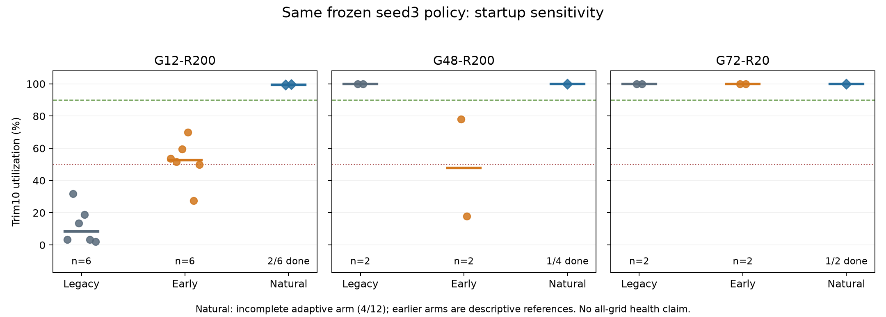

# 启动诊断：首反馈方案失败，自然接管仍待完成

当前没有新增健康基座，也没有启动seed7重训。原模型大多数场景的能力仍值得保留，但不能通过删除弱场景、改评分或只挑好的重复来验收。最新状态是：**40次配对完整完成且首反馈方案FAIL；另12次自然Cubic诊断只完成4次，INCOMPLETE_INTERRUPTED。**

本轮240分钟授权从北京时间2026-11-12 22:17:42至11月13日02:17:42。11月13日下午恢复会话时已过截止，只收回既有小指标、读取日志摘要及检查资源，没有新TCP实验、TF诊断、优化或探索，也没有自动续用剩余额度。两机最近启动时间约为11月13日15:11；中断日志没有证明具体是谁或什么导致了上轮停止，不归因为RL或代码异常。

## 同权重40次给出的结论

全部使用已冻结seed3终点step-6013196，策略SHA256为`631683b939596cabc85262e2294123c462913bf6b836dff10b84501644ad60e0`；H0参照单列。两台各顺序一个冻结流，40次全部完成、执行错误0。动作映射/ID、完整60秒包时钟、模型不变、优化与探索计数0、接管模式与清理审计通过。沿用原逐格健康门和任一次利用率低于50%的灾难门。

下表是当前候选的trim10利用率中位数；不是全24条件均值。

|条件|原辅助启动|首反馈接管|结论|
|---|---:|---:|---|
|G12-R200，分别6次|8.38%|52.72%|两者均未过门；低于50%分别6/6、2/6|
|G48-R200，分别2次|100.00%|47.94%|首反馈引入退化，两个值78.14%、17.74%|
|G72-R20，分别2次|99.97%|99.99%|吞吐保持；仍保留首10秒保护门|

另三个哨兵G12-R100、G24-R50、G36-R100的首反馈trim10吞吐较好，也不能抵消上述失败。H0在G12-R200的原启动三次67.37%、80.49%、72.16%，首反馈三次96.90%、93.89%、85.51%；这说明两个权重对启动协议的敏感性不同，不能把H0改善推断为当前权重也已修好。

原40的[逐run结果](../evidence/baseline-health-validation-20261112/screen-latest.json)、[原评分](../evidence/baseline-health-validation-20261112/screen-assessment.json)及[接管/动作/模型审计](../evidence/baseline-health-validation-20261112/screen-source-and-handoff-audit.json)全部保留。原seed3旧启动72次的FAIL也不改写。



## 自然Cubic接管的4次好结果有多大意义

这条自适应诊断在40次负面证据后单独登记：保留原`ssthresh<cwnd`接管条件和接管前遥测轮询，只移除RL第一动作前的1.1倍写窗；接管后策略、动作和20ms执行源码不变，没有QC或fallback。12项固定为G12-R200×6、G48-R200×4、G72-R20×2；前两项兼作工程门并包含在12项中。

|条件|已完成/登记|已完成trim10利用率|mean queue|实际RL接管时间|
|---|---:|---|---|---|
|G12-R200|2/6|99.5087%、99.5448%|13.297、13.228ms|2.150、2.149s|
|G48-R200|1/4|100.0000%|26.316ms|2.228s|
|G72-R20|1/2|99.9532%|5.317ms|0.177s|

四次均真实进入RL闭环，原逐格门在这个已观察子集上通过；没有把全程Cubic当作RL表现。两个G48-R200尝试只有49.594、51.873秒包日志且缺result，保留为中断部分日志，不填成成功、失败分数或60秒结果。其他六项未开始。整个12项**尚不能评分为PASS**，不估计故障率，不进入独立96次确认或seed7重训。

自然组是看到原40结果后追加的探索臂，旧组只是前轮描述性参照，不是同期随机因果对照。四次也包含两次事前工程门，不能包装成四次独立确认。[完整状态与可复算指标](../evidence/baseline-health-validation-20261112/startup-validation-assessment.json)、[四次工程审计](../evidence/baseline-health-validation-20261112/natural-completed-source-and-handoff-audit.json)明确保留这些限制。

## 现在能解释什么，不能解释什么

第一，启动执行链确有可测的异常冲量。原辅助启动在G12-R200交给RL前把cwnd写至约322万—384万包，不能把cwnd等同实际在途包；同格首10秒丢包率中位约20.98%。去掉辅助但过早交给RL后，初窗只有11—13包，第一条策略仍作25%减窗，迅速碰到4包下限，首10秒利用率中位仅9.58%。这两个极端都没有构造一个合适的策略接管状态。

第二，自然接管保留了已有路径探测。G12-R200两次实际接管cwnd759/758、packets_out758/758，约2.15秒；G48-R200为982/978，约2.23秒。策略仍有最初几条强减窗，随后这些已完成run能保持高吞吐，因此不能把“首条策略25%”单独当成失败的充分条件。

第三，状态归一化和恢复覆盖仍是可能的耦合因素。首反馈G12-R200第一个**保存的转移行**max_bw折成遥测Mbps仅约0.33—0.39，自然组约11.55；这是保存行，不能冒充reset的第一状态，也不是链路容量利用率。部分低吞吐首反馈run后续观察峰值已接近链路速率，故“max_bw始终太低”不能解释全部失败。[52个登记run的已有反馈/首十控制摘要](../evidence/baseline-health-validation-20261112/all-startup-feedback-audit.json)包含6个未开始项，不是52个完整评测。

第四，运行内核build链接对应源码显示Cubic仍逐ACK执行slow start/拥塞避免，DeepCC enable=2附加自定义pacing；应用写窗之后的ACK恢复/PRR仍可能再改窗口。`natcp_update_by_app`只钳位并printk，没有重置Cubic epoch。源码链接与版本不是整个运行内核逐字节重建证明，也尚未用每个内核事件证明全部因果。没有改内核、sysctl、奖励、模型或回放。

因此，最合理的下一步是先完成这条有限的同权重诊断，再独立验收，不用一次长训替代启动链路核对。这些证据也不支持把当前弱点简单归因为训练时间或集群规模。

## 训练饱和与可重复性的边界

当前学习core仍是`9bb1500eaf791bcb0e97724c63dcb725323dd5cd`。先前完整6M中早期约30万样本有tanh精确饱和和很小actor梯度，约73万开始明显恢复，之后仍有短暂反复。在线BN去重、目标BN一致、独立critic Adam和target去重有独立工程证据，但**未证明全部历史坍塌只有一个原因，也未证明每个新seed都会恢复**。[与H0配方差异及饱和诊断](BASELINE_HEALTH_VALIDATION_PLAN_20261112.md)保持原结论。

即使自然接管最终把当前模型验收为健康，也只证明这个权重和部署协议。下一次seed7必须保持同一学习core、24actor、原回放/噪声/U=.1和legacy训练native，仅改变训练seed；两个seed统一用已验证的自然接管评测。训练也换启动协议属于另一个配方，不能混称精确复跑。

## 续接方案与交付状态

[下一窗口草案](../evidence/baseline-health-validation-20261112/continuation-plan.draft.json)仅离线准备、未授权也未运行：先两机补齐8个缺失重复槽，两个中断尝试保留并用新run ID重做；选择依据只有完成性，不按成绩。合并原4项后按原12项与原门评分。若通过，通知开启其余三台，独立完成自然接管当前24×3＋同启动H0全24×1，筛查数据不复用。只有完整确认PASS且余量≥150分钟才最多一次seed7 fresh6M及72＋6参照，末10分钟收尾，不自动第二次长训。

尚未满足归档/清理前提，本轮没有删除其他基座代码、覆盖H0或启动双动作训练。保留当前候选、原FAIL、中断证据、所有模型与历史。自然候选的native默认重建与原632bca97逐字节相同，首反馈控制重建也相同；新自然ELF SHA为`3def82b33ba9848313eaab8b0e3779b643d30a333b314171b5a451358b4b50f8`，构建源码commit`80d993d`，并非学习core版本变化。

恢复后两机[当前终检](../evidence/baseline-health-validation-20261112/closure-post-interruption.json)通过：本轮进程/登记共享内存/端口均0，旧51模型/core/sysctl及已用模型、native、helper未变。重启后的终检不倒推中断前清理成功。没有连接其他三台，也未下载大checkpoint、replay或完整逐包日志；只取已有结果与云端聚合小摘要。

复算：

```sh
python tools/analyze_baseline_startup_validation.py evidence/baseline-health-validation-20261112 --output /tmp/startup-assessment.json
```

Claude上一轮只独立核对仓库内核补丁三处，未直接读运行内核树或本轮新native/raw数据；自然接管建议来自那次讨论。当前4/12中断结果是否已再发对方，以后续明确的复核记录为准，不预先宣称双方达成健康结论。
