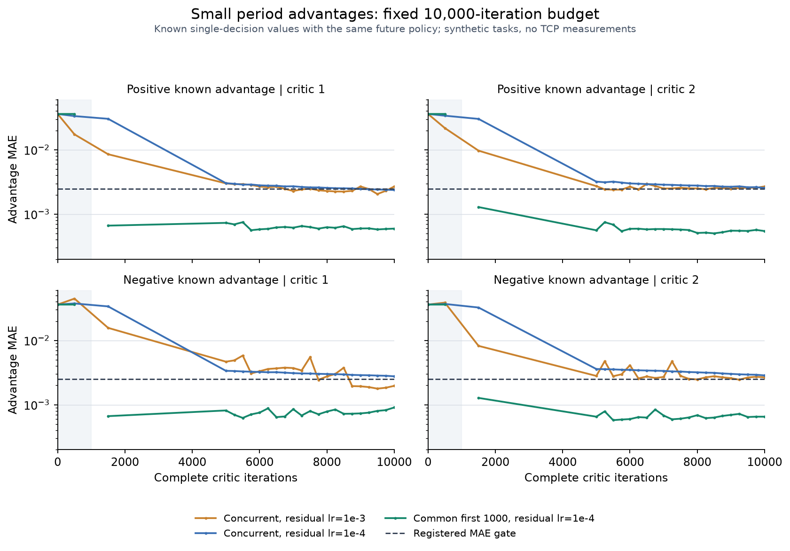

# 连续双动作v4：Claude补丁本机复核与公共价值校准

**本轮离线关键检查通过，可以准备云端短机制核查；尚无新TCP模型、性能或CPU收益结论。** 原健康基座main/c677保持不变。全程没有SSH、新TCP、云端训练或独立fixedMTP训练。

用户提交的patch与GitHub `2d2de615f16c04263cc20e33b0861a983bf4099d`的稳定patch-id均为`4311e5c85038e562155a72bda5e65bb3acb82df4`。在独立工作树复核，没有改Claude原分支。其[原结果](CLAUDE_OFFLINE_RESULT_20261117.md)与失败证据保留。

## 1. 接受哪些修复，修正哪些判断

**覆盖分组修复有效。** 旧nearest-anchor桶与连续对数探测分布不匹配。我们独立用真实Replay模拟24 actor、300k容量、480秒/actor，共440428行：原末桶最低67行，达不到128；新等宽log桶最低分别9896/196/185/199/191行，全部达标，首次60秒采样点达标在240秒。假设仍是空RTT比例2%和四档minRTT；这是覆盖可达性模拟，不是测得的TCP状态分布，也不是所有可能行为分布下“永远”不放行的证明。五桶只是审计，时间动作仍连续。

**流水线fixture修复有效。** Claude版本在实际TF1.14中自然通过0→1→2；1500合成样本、494完整critic迭代、490次双动作actor更新、最终欠额0。fixture把数据预先入FIFO，门在第2/4次critic迭代放行；不能把纯Python排程模拟的“第235行放行”当成TF的实际时序。门槛在fixture中刻意缩小，不用于真实训练。

**独立残差Adam执行正确，但仅减学习率没有解决值门。** 本机确认槽位归属、两分组读取同一更新前梯度、BN冻结、恢复和完整链式梯度正确。原登记任务在TF中仍只有3/6格过门，迁移初值水平诊断也只有4/6。小学习率减小了波动，同时留下稳定偏差。

“主因已经确定是Adam抖动”应降为受控证据支持的部分机制。实际步长取决于一二阶动量和梯度；优势变化还取决于两动作的特征差与参数变化的相关性，不能仅凭`√69×lr`认定根因。[TF1.14 Adam实现](https://raw.githubusercontent.com/tensorflow/tensorflow/v1.14.0/tensorflow/python/training/adam.py)和[原论文](https://arxiv.org/abs/1412.6980)给出相应更新式。

两套“迁移初值水平”诊断也不同：TF把两个critic的较小初值作为共同标签，NumPy分别用各自初值。这里两个状态的实际初值Q1约148.081/102.440，Q2约148.386/105.253；TF第二个critic仍需校准公共水平。把各自标签改成初值不等同于已经实现和检验所有`Phi+A`价值势方法，不能据此整体否决它。当前先采用下面更小的顺序修复，没有引入Phi。

## 2. 新增的最小修复：先校准公共价值，再学习周期差异

保持原窗口Q主干、物理周期残差、原奖励、成本.01、实际dt折扣、连续时间头和窗口范围。新增`critic_common_calibration_updates=1000`：

1. 前1000次完整critic迭代，仅更新迁移主干；周期残差参数、Adam的m/v与时间步全部冻结。
2. 随后同时更新主干和周期残差，学习率分别1e-3/1e-4。原actor校准及前向校准门仍保留，最终两个动作都学习。
3. actor不能在公共校准完成前更新。配置必须满足公共校准小于原actor校准最低迭代数；恢复与新准入契约绑定该键。

这检验的是：量级很大的公共价值误差会先污染本应学习细小周期差的残差，让两个部分竞争拟合同一偏移。它是本受控任务中得到支持的优化机制，尚未证明是历史TCP弱策略的唯一原因。

先用独立驱动器进行固定预算对照，再接入实际`Model.critic_step`重跑原验证工具。三种配方都是总计10000次完整critic迭代；新配方周期支路只有9000次更新，实际Adam应用38000次，原同时学习配方40000次。没有增加预算、改门槛或挑最佳checkpoint。TF1的初始化可能受构图顺序影响，新增阶段操作放在网络随机初始化器之后；额外检查确认两配方所有在线/target网络初值逐位一致，见图检查中的`initial_network_sha256`。

## 3. 原登记值门结果

最小已知单步优势.00995，MAE门仍是.0024875，排名门95%；后继仍是同一20ms策略，不混作永久固定周期价值。每格为最终第10000次迭代，非最佳中间点。

|任务|同时学习，残差lr=1e-3，Q1/Q2 MAE|Claude lr=1e-4，Q1/Q2 MAE|公共校准1000后开放残差，Q1/Q2 MAE|
|---|---:|---:|---:|
|正优势|.00268335 / .00269260|.00237147 / .00254949|**.00059544 / .00054550**|
|零优势|.00026957 / .00022634|.00012461 / .00010427|**0 / 0**|
|负优势|.00196619 / .00266809|.00276473 / .00285628|**.00090662 / .00065231**|
|过门格数|3/6|3/6|**6/6**|

新配方所有非零任务排名100%，5000—10000步、每250步记录的全部点均在幅度门内；额外迁移初值水平诊断6/6通过。此稳定性只指这个单seed、两个构造状态的记录窗口，不是多seed收敛保证。



图只显示正/负任务；零任务见表。公共校准的切换附近没有1000步实测点，曲线在该未观察区间断开，避免插值暗示校准结束前已开始学周期。CSV、SVG、PDF一并保留。

为区分表达和优化，另冻结实际TF初始化特征，只用已知构造标签直接拟合最后线性层，在TF float32中得到约0—1.06e-5的优势MAE。它支持“此小任务可表达”，**不作为原Adam门的替代、真实TD校准或部署算法**。

## 4. 实际执行范围及其他修复

- **79项joint测试＋200项tools测试通过。** 原独立scalar窗口/critic迁移回归通过，512输入窗口误差0，原target/BN及保存恢复契约保持。
- 实际TF1.14新图通过：初始窗口误差0；初始周期误差1.1444e-5ms；实际探索T重算窗误差1.788e-7；teacher时间梯度0；两头可更新；BN统计不变；链式梯度约1.49e-8；保存恢复、推理导出误差0；旧schema拒绝。阶段小fixture用W=2并明确记录，确认前两步残差及Adam时钟不动，第三步开放；生产能力任务另用完整W=1000。
- 实际learner FIFO再次通过：小fixture W=1，494完整critic、490 actor、1974次实际critic Adam应用、980次actor Adam应用、欠额0。所有四个critic Adam的beta时钟与各自更新次数匹配。
- 修正`critic_optimizer_ops`原来固定加2的记账：分组后实际是4，公共校准期为2。保持逻辑`global_step`和物理经验额度原义，不能把global_step当实际Adam次数。
- 能力脚本原先FAIL仍以进程码0退出，现改为FAIL退出1；零更新负控已验证退出1，防止后续流程误放行。科学判定始终读JSON，历史FAIL不因旧退出码0而变成PASS。
- NumPy/TF相同权重下，初始Q误差最高约1.59e-5，梯度缩放误差最高3.40e-7；一步Adam和100步诊断吻合。NumPy使用float64、不同初始化，以及上述初值标签区别，不能要求独立10000步终点逐位一致。此对照显式关闭公共校准，以匹配其同时更新算法，不冒称已重建新阶段逻辑。
- fixture不再覆盖已有`--keep`证据，失败目录重名时另存；清理前关闭Session。原失败证据和Claude原始报告没有删除。

## 5. 重现与证据

新证据在[`evidence/joint-continuous-local-verify-20261117`](../evidence/joint-continuous-local-verify-20261117)，先读`key-results.json`和`README.md`。本机完整stdout/stderr、合成pipeline checkpoint仍在`D:/Canopy/experiments/joint-continuous-local-verify-20261117`，公开仅小结果、图与必要核对信息；这些合成checkpoint不能当TCP模型。

```powershell
$py = 'D:/Canopy/experiments/joint-healthy-offline-20261113/python36/python.exe'
$cfg = 'templates/joint-healthy/joint-continuous-v4.json'
$states = 'evidence/joint-cost-repair-20261116/real-frozen-probes.npz'
& $py -B -m unittest discover -s tests/joint_healthy -p 'test_*.py'
python -B -m unittest discover -s tools -p 'test_*.py'
& $py -B tools/verify_joint_continuous.py --config $cfg --states $states --output graph.json
& $py -B tools/verify_joint_healthy_pipeline.py --config $cfg --output pipeline.json --keep new-pipeline-scene
& $py -B tools/check_joint_continuous_capability.py --config $cfg --states $states --output capability.json
```

`tools/check_joint_common_level_warmup.py`是独立顺序诊断；`diagnose_joint_period_head_fit.py`是已知标签容量诊断；`verify_joint_numpy_tf_parity.py`核对独立重建；`plot_joint_continuous_value_audit.py`只读取已保存JSON。它们没有新TCP接口。最终交付收据另记录commit、源文件哈希及保护校验。

## 6. 下一轮云端顺序

本轮没有沿用旧费用窗口。用户准备开启服务器时，先登记新的有限窗口；先开learner和actor1即可开始短机制核查，不直接开正式长训。

1. 同权重连续非锚点周期27/63/133ms，按少量R20/R200条件核对真实执行时间、成本一次扣除、无隐藏20ms读取；记录稳态cwnd/ssthresh和CUBIC阶段。`T<=2RTT`仍是条件近似，不硬裁剪T，也不改内核/窗口范围。
2. v4初始策略24条件×1冻结健康检查，配同轮基座参照；必要时扩到五台并核对源码/native/模型哈希，生成当前实现专属准入证据。这是快速筛查，不冒用旧24×3正式门的PASS名称。初值函数相同与离线通过不能替代这一步。
3. 通过后做事先登记的600秒/actor可学习性短测，至少两个中途冻结点；自然校准放行、两头确实学习、BN不漂移、满回放联合更新容量/物理账本/排空正常，并观察冻结无探索策略的调用与网络表现。物理额度仍为.1/20ms，24 actor持续暴露时约需120次完整critic迭代/秒；周期变长不会自动降低这笔更新额度。先核对learner真实容量，保留1 learner＋24 actor，不因整机低利用率盲目扩容。少调用不等于CPU收益。
4. 真实短测通过、剩余预算足够且用户已授权时，才正式训练及匹配冻结评测。最终逐格吞吐、mean/P95和调用降至少20%的门不变；实际CPU另测。单seed构造任务不能证明两动作已在TCP中有效，更不能据此宣布健康双动作模型。
