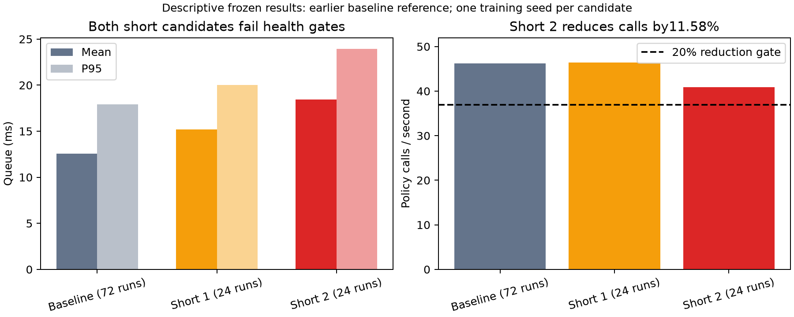

# 双动作非零调用成本修复（2026-11-16）

当前为候选，未替换健康单动作 seed3。上一轮 cost=0 终点的健康门失败，负面模型、代码及报告保留。本轮在独立分支/五机独立目录运行，最多两次短准入、一次 3600 秒/actor 正式训练；不训练独立固定 MTP 组。

## 修复依据

从旧冻结包日志重建 1059 个真实82维输入，覆盖 G4 初始化和旧终点的24条件各三重复。重建动作误差分别为4.27e-6、9.60e-6。共同输入下，旧权重/新 BN、 新权重/旧 BN、两者都新，相对旧策略窗口 RMSE 为0.883、0.722、0.267。权重与统计共同适应，不能仅换回旧 BN。保存的训练轨迹在首次500次 actor 更新后已有0.419窗口 RMSE；这不是中间 checkpoint 的闭环性能测量，也不能据此断言唯一根因。

20个旧真实流的重聚合诊断中，固定旧峰值分母的回报差最大约1.04%；端点峰值代理约5.07%。两者不是实际改变周期的 TCP 反事实。ACK/损失区间计量加端点 SRTT 仍是近似，不宣称效用积分完全无周期偏差。

## 新候选的明确契约

- 保留原 Orca 效用及实际时间 SMDP：`D=0.995^(actual_dt/0.02)`，`R=u*(1-D)/0.005-c`。每次真实决策扣一次 `c=0.01`；该系数不是实测 CPU 换算。无 Canopy 性质约束。
- 从健康窗口 fresh 初始化；保留在线和 target 的迁移 BN 均值/方差，窗口权重和 beta 继续训练。两分支独立 Adam，窗口学习率1e-5、时间1e-4。
- 训练期加入同状态原70维窗口输出的软 Huber 参考：`10*stop_gradient((20/planned_ms)^2)*Huber(delta=.1)`。这是额外策略先验，不伪装成调用成本或安全证明。长周期下参考减弱，时间头不从此参考损失获得梯度。没有硬动作覆盖、fallback 或窗口冻结。
- teacher 标签只在 learner 接收真实经验时计算并缓存，部署 actor 不增加 teacher 推理。当前协议、状态构造、动作映射、native 与原 G4 初始化保持一致。
- 24 actor，300k 均衡回放，每20ms入库真实经验0.1次完整更新；正式180秒重连，短准入30秒重连。不能把载权重与重新建连称为无缝恢复。

模板：[joint-cost-preserve-v2.json](../templates/joint-healthy/joint-cost-preserve-v2.json)。历史默认保持原义，必须显式使用新模板。

## 校验与阶段门

58项双动作、200项工具、7项scalar测试通过。实际TF1验证显示两分支参数均变化、在线/target全部BN统计逐位不变、参考损失对时间头梯度为零、独立优化器槽位及保存恢复正确；临时合成优化不等于网络训练通过。529个真实 G4 输入的新初始化最大动作误差4.27e-6。

初始化准入明确复用历史完整24×3见证，并以当前函数/真实输入/native桥绑定新源码；没有冒称本轮重跑144次初始化评测。当前学习模型仍须独立短冻结门：全24条件、每格利用率≥95%、总体利用率损失≤1pp、平均及P95排队≤参照120%、无排队灾难及full/trim丢包；实际调用至少减少20%。短测使用全部旧72基座参照，时序差异保留；正式终点必须新做同主机交替的72候选+72基座参照。

Claude 已复核诊断摘要与方案，提出长周期 teacher 先验可能阻碍适应，我们在新候选学习前改为周期衰减，并预设按周期记录窗口偏移。对方撤回“每个状态Q40必须超过Q20”及用混合后继短回报预测40ms最优的建议；没有独立审查代码或原始数据。

首个720秒/actor短准入已完成：660700真实经验、83821完整critic更新、约49321联合actor更新，欠额0。满回放170秒实测109.51更新/秒，投影长训额外排空344.97秒。两分支参数改变、在线/target BN统计逐位未变。

首个24条件单重复冻结结果为 **FAIL**：利用率99.789%、mean queue15.197ms、P9520.042ms；全部旧72基座参照为99.690%/12.553ms/17.917ms。平均排队超过120%门，调用46.46/s，没有开销收益。未启动正式长训。

## 第二次、最后一次短候选

首短终点500个真实状态中，时间隐藏特征范数中位12358、输出残差中位−126527，softsign局部导数约6.28e-11。终点critic在20ms附近有69%状态的时间梯度为正，但此critic本身未经反事实校准，不能将其当正确方向证明。它支持“特征放大和有效饱和”诊断，不能证明唯一根因。

第二候选保持成本0.01及原短门，从健康基座重新初始化，新增两项：

- 时间网络fc2特征先做unit-L2归一化，再进入原零初始化输出层。初始窗口/MTP函数仍一致；没有硬动作限制或额外时间正则。输出权重仍无界，不能宣称饱和永久被排除。
- 两个online critic的输出bias减去`c/(1-gamma^(0.0216/0.02))`，随后硬拷贝target。21.6ms来自原健康基座约46.3调用/秒的实测间隔，是常周期未来调用成本的近似初值，不是真实joint价值。实际奖励和TD不变。常值效用、独立周期完美拟合的解析例子显示，不修正的值初始各周期残差都为−c，成本的周期优势靠慢target传播；这只是说明，不等于实际神经优化器轨迹。

两项同时改动，不能从这一轮归因各自贡献。60项joint测试及真实TF1校验通过，529个原初始化真实输入仍一致。

第二短完成656064真实经验、84191完整critic、51191联合actor更新，欠额0；满回放实测106.02更新/秒，投影额外排空474.89秒。24冻结全部完成、零执行失败。结果仍 **FAIL**：

|指标|旧72次基座参照|短1：24次|短2：24次|
|---|---:|---:|---:|
|利用率|99.690%|99.789%|99.516%|
|mean queue|12.553ms|15.197ms|18.421ms|
|P95 queue|17.917ms|20.042ms|23.958ms|
|调用/秒|46.213|46.460|40.863|

短2调用少11.58%，但mean queue高46.74%，另有低利用率/逐格排队灾难，不通过原门。实际512个末期回放状态的纯周期均值22.36ms，softsign导数中位0.0232、最小1.88e-4；归一化缓解了首短的有效饱和，不能把这一点当性能成功，也不能把当前模型笼统叫成同一种数值坍塌。两个头仍学习，BN逐位不变。

## 后续补丁：仅离线，待调整短准入次数上限

联合阶段没有持续覆盖周期，是本轮核实的缺口：最后300000条真实回放中，计划周期≥40/80/120ms分别只有226/8/7条；多个actor没有80ms经验。原实现显式五周期probe只在校准期使用，JOINT仅有std0.2高斯动作噪声。接近20ms时，到80ms所需的动作扰动超过6个标准差；早期校准数据被环形回放挤出。早期校准coverage PASS并不表示终点仍有长周期覆盖。扩大集群或单纯延长时间不会自动修复这一探索分布。

已离线实现：可选`joint_period_probe_probability=.1`，在JOINT每次真实决策以10%概率均匀探测五个合法周期，并记录`joint_period_probe`，窗口仍按现有联合策略及噪声学习；默认0保持旧Gaussian RNG及动作逐位一致。冻结推理不做probe，不是独立固定周期训练组。每次实际决策仍按真实dt结算一次调用成本。

独立的解析能力任务使用同64个真实输入及已知构造价值`Q=200-.01/(1-.995^(dt/.02))`：5000次时间头更新，1e-4学习率只从20.5到20.56ms，1e-3到137.77ms。它说明归一化后需要校准学习尺度，不能用来断言真实TCP的Q值、最优周期或性能。待测候选采用时间学习率1e-3，其他窗口/成本配置不变；两项改变仍不能隔离贡献。

63项joint测试与实际TF检查通过，模板为[joint-cost-coverage-v3.json](../templates/joint-healthy/joint-cost-coverage-v3.json)。截至本报告，第三候选未部署、未运行真实网络。原4小时授权只允许两次短准入，这两次已用完；已向用户申请原截止不变的额外一次600秒短准入及24条件冻结，仍须原健康/调用门全部通过且留110分钟，才启动原已授权的唯一3600秒正式训练。不自动增加次数、延长时间或训练独立fixed组。

## SMDP与后续研究边界

两轮真实回放duration/discount/一次cost重建误差分别约3e-8和5e-7以内，说明当前算术与账本一致，不能代替真实效用积分或Q排序校准。Orca原效用在SRTT≤1.25minRTT内对排队不惩罚，与本项目严格mean/P95门存在目标差距；本轮没有偷偷修改此奖励来掩盖FAIL。持续探索是必要的数据修复，未证明足以解决排队和时间策略耦合。

新读取既有冻结原始反馈进一步核实：G12-R200/G24-R200的包日志排队分别31.21/31.38ms，但反馈时长加权约99.80%的延迟乘子仍为1，观察效用约0.9967/0.9985。G36-R50已受到约5%的平均延迟惩罚而仍退化，因此奖励平台不是所有弱项的唯一原因。反馈SRTT超额与包日志排队是两种测量，不能混作同一个精确积分。

后续还需要量纲核对窗口—频率耦合：当前每次执行的窗口乘数为`floor(100*4^a)/100`。即使同样的窗口输出，调用频率变化也会改变单位时间施加的窗口修正；忽略CUBIC和整数化时，其对数速率为`log(multiplier)/dt`，这不是TCP闭环等价定理。以原20ms的每次输出作软参考、再随周期削弱参考，并不等于保持原控制速率。可以研究按物理时间校准的软参考，同时处理整数窗口脉冲；目前只提出分析方向，未更改协议、窗口动作或奖励。持续探索/学习尺度补丁也不能代替这一耦合验证或低排队目标的重新定义。

调研核对：[TaCoS论文](https://arxiv.org/html/2406.01163v3)把控制动作与持续时间共同优化，并在模型无关实验中使用SAC；其有限时域建模不能直接当作当前折扣TCP闭环的验证。[官方实现](https://github.com/lasgroup/TaCoS)可供后续对照。[OpenAI DDPG说明](https://spinningup.openai.com/en/latest/algorithms/ddpg.html)明确区分带噪声的行为探索与无噪声评测；本项目的长周期覆盖必须用真实入库分布检查，不能仅凭配置里有噪声就认定充足。

Claude已读四轮摘要及新方案，明确未审代码/原始数据。其补充是持续probe会改变训练行为与开销，收益只看冻结；时间学习快于窗口两个数量级可能造成漂移，必须按周期记录窗口偏离teacher；健康/P95门不能因调用下降而放宽。

解析能力任务可在原TF1环境复算（没有TCP）：

```sh
$ORCA_PYTHON tools/check_joint_time_learning_scale.py \
  --config templates/joint-healthy/joint-cost-coverage-v3.json \
  --states evidence/joint-cost-repair-20261116/real-frozen-probes.npz \
  --output time-scale-check.json
```



[逐24条件比较表](../evidence/joint-cost-repair-20261116/tables/all24-short-comparison.csv)保留所有条件，没有筛掉弱格。63项joint＋200项工具＋7项scalar测试均通过；合成FIFO/回放/账本检查也通过，这些均不等于第三候选已在线验证。

完整的第二短模型与policy合计4,820,590字节已本机SHA校验；replay、原始日志、历史checkpoint仍留云端。五机在两短结束后的归属检查通过，无本轮进程/IPC/listener，99文件受保护基座不变。这是阶段空闲核查，后续若获得额外次数批准则须重新登记实际启动。

**阶段交付状态**：两短均FAIL，正式训练启动数为0。原登记最晚正式启动为北京时间09:43:57，该时刻已过，不能在原预留条件下自动开启3600秒长训。额外短测次数的请求仍待用户答复；即使后续允许短测，也须遵守11:33:57任务截止、11:53:57硬截止及原110分钟正式预留，不把剩余预算当作无条件长训许可。原健康基座仍是唯一当前基座。
