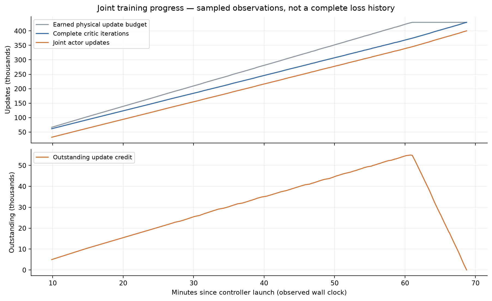
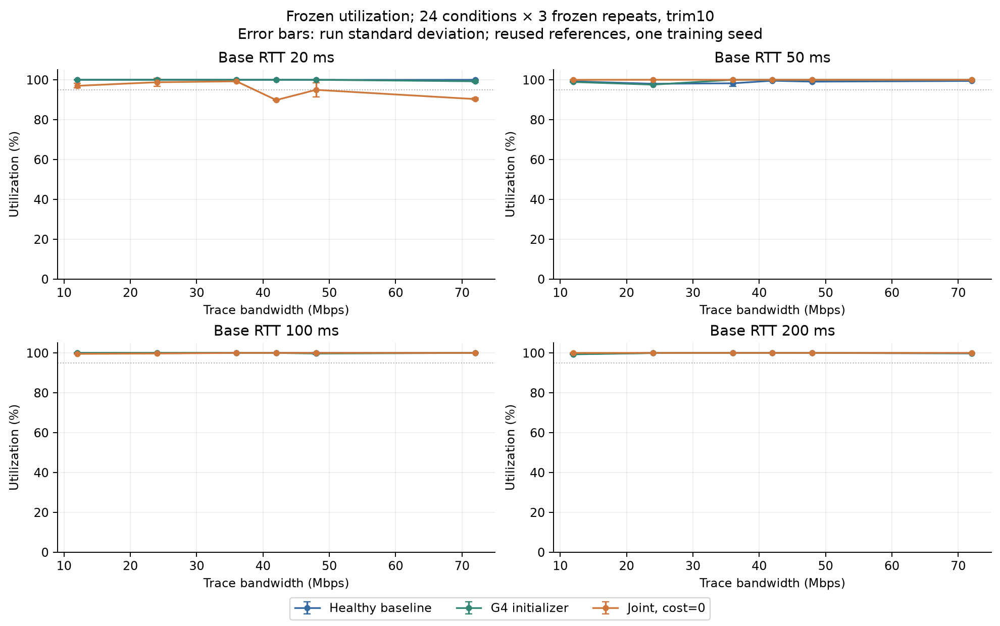
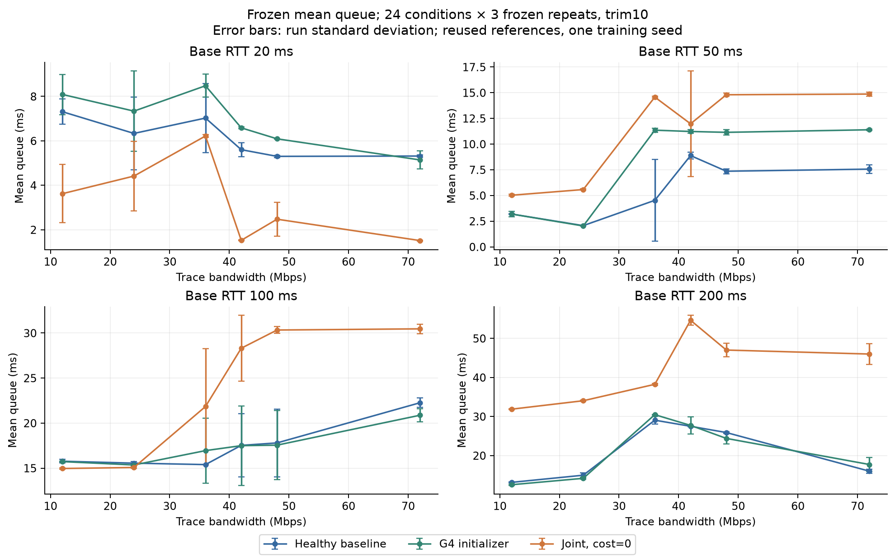
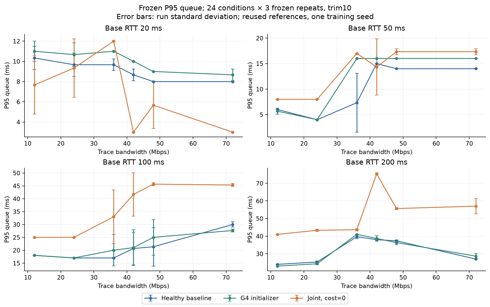
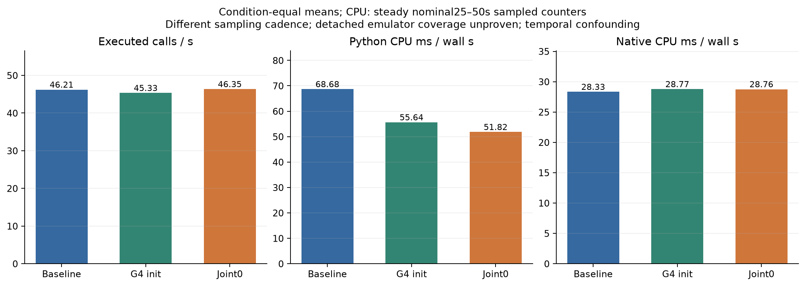
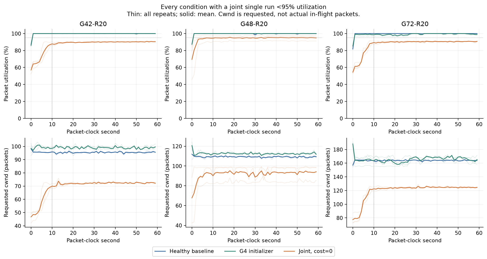
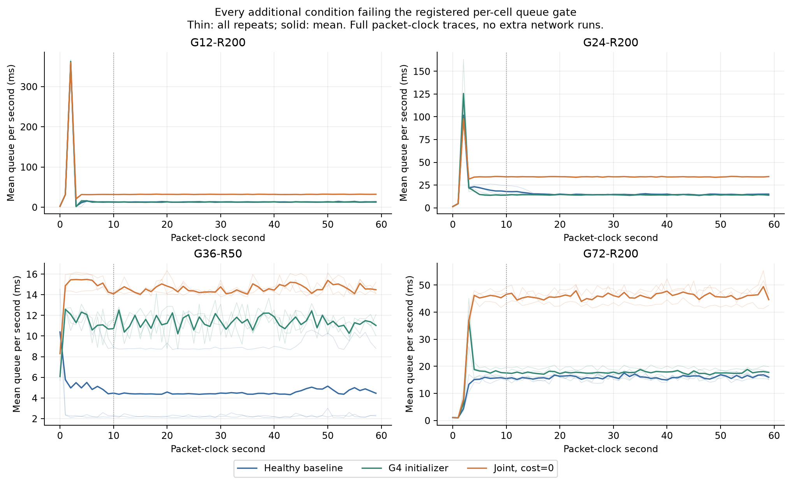

# 双动作G4：一次完整联合训练及终点评测

**结论：PERFORMANCE_FAIL。** 正式训练完整完成，72次新终点测试全部执行；原基座仍由`CURRENT_BASELINE.json`指定，本轮不替换它。

这是用户重新授权的两小时窗口：2026-11-15 21:56:33—23:56:33，北京时间，五机保守10机时，23:41:33任务截止、最后15分钟收尾。只做一次正式3600秒/actor联合训练，没有独立训练固定MTP组，没有追加第二次长训。

## 唯一模型及训练账本

运行`joint-g4-startcoverage-seed3-3600-2156`于22:01:11启动。1learner＋24actor，各3600秒真实物理经验、180秒重新建连、300k回放。迁移健康seed3窗口，重新创建优化器和回放；没有加载短准入权重，也没有挑选中间checkpoint。82维状态、cwnd/MTP双连续动作、20—160ms；原Orca区间效用、decision_cost=0，无Canopy性质、QC、fallback或容量oracle。

|项目|实际结果|
|---|---|
|真实入库经验|3,470,420|
|累计物理经验|86400.281157秒；24actor各≥3600秒|
|完整critic迭代／两critic优化器操作|429,699／859,398|
|双动作actor／target更新|400,199／429,699|
|最终更新欠额|0；generated/enqueued/inserted逐actor一致|
|唯一终点|`step-3470420-final`|
|运行源归档|`59076959520728f6e26182128c9cb347c00868b8`，15项LF归一指纹一致|

此Git提交在启动后归档了相同运行字节，不表示云端checkout过该提交或训练中热改。原main/c67717d、99文件保护包和原51模型保留。

两个校准阶段自然通过后才开放联合学习：
- phase0：28500完整更新；最大normalized TD RMSE 0.014841、8步带bootstrap短回报RMSE 0.036142。
- phase1：29500完整更新；最大normalized TD RMSE 0.014465、8步带bootstrap短回报RMSE 0.035838。

这些不是完整Monte Carlo价值证明。短块含行为时间探测和目标窗口平滑；历史帧共享，optimizer-excluded不等于统计独立。

训练中记录的最大更新欠额为54,966，最大FIFO积压16，均衡采样贡献差最大1。学习器满回放更新慢于24actor的名义额度产生速度，故采样后实际补齐；没有用计数回填代替优化。最终欠额为零，完整经验/动作/调度/奖励/折扣/连接清理审计通过。

## 冻结性能：全部24条件和三次重复

新模型72次；复用今天初始化完整150次中全部144主参照（base72、G4初值72），另6次坏格重复保留在历史记录。没有按分数挑参照。每个新终点scenario/repeat与原基座匹配同一主机，但三组并非同时随机交错，G4不同时满足两组主机配对，时间漂移未排除。

|模型|利用率|mean排队ms|条件等权P95 ms|条件等权P99 ms|
|---|---:|---:|---:|---:|
|原健康基座（复用参照）|99.6902%|12.5529|17.9167|19.6667|
|G4未训练初值（复用参照）|99.7644%|13.4558|18.9444|20.8333|
|本轮联合终点，cost=0|98.7192%|19.9715|27.2639|29.7778|

以上为trim10、条件等权，P95/P99是各条件尾分位再等权，不是混合全部包的总体分位。执行失败0次。原健康门结果：`PERFORMANCE_FAIL`；原因：c3:queue_disaster, c4:queue_disaster, c11:queue_disaster, c15:util_below95, c16:util_below95, c20:queue_disaster, c21:util_below95, queue_mean_ms:above120percent, queue_p95_ms:above120percent。

门槛未修改：每格平均利用率≥95%、总体比base下降≤1pp、总体mean/P95≤base的120%、每格mean≤max(2×base,base+10ms)、full和trim零丢包、接管≤10秒。每次完整60秒包时钟、模型/BN不变、优化和探索0均由执行契约核对。小差异解释护栏在新终点数据前登记：利用率≤1pp、mean≤2ms只称相近，不是统计等效检验。

|条件|joint三次利用率%|joint mean排队ms|base mean排队ms|joint P95 ms|
|---|---|---:|---:|---:|
|G12-R20|96.449 / 96.181 / 98.293|3.6215|7.3101|7.6667|
|G12-R50|99.974 / 99.960 / 99.976|5.0201|3.1876|8.0000|
|G12-R100|99.541 / 99.539 / 99.547|14.9553|15.7628|25.0000|
|G12-R200|100.000 / 100.000 / 100.000|31.8756|13.1360|41.0000|
|G24-R200|100.000 / 100.000 / 100.000|34.0354|14.9633|43.3333|
|G24-R20|99.933 / 99.985 / 96.383|4.4142|6.3335|9.3333|
|G24-R50|100.000 / 99.998 / 100.000|5.5743|2.0619|8.0000|
|G24-R100|99.776 / 99.645 / 99.742|15.0699|15.5500|25.0000|
|G36-R100|99.997 / 100.000 / 99.999|21.8360|15.3897|33.0000|
|G36-R200|100.000 / 100.000 / 100.000|38.2396|29.0533|43.6667|
|G36-R20|99.325 / 98.985 / 99.397|6.2183|7.0249|12.0000|
|G36-R50|100.000 / 100.000 / 100.000|14.5707|4.5242|17.0000|
|G42-R50|100.000 / 100.000 / 100.000|11.9727|8.8792|14.3333|
|G42-R100|100.000 / 100.000 / 100.000|28.3089|17.5236|41.6667|
|G42-R200|100.000 / 100.000 / 100.000|54.6414|27.4918|75.3333|
|G42-R20|90.178 / 89.603 / 89.648|1.5210|5.6017|3.0000|
|G48-R20|97.630 / 91.052 / 96.153|2.4725|5.3010|5.6667|
|G48-R50|100.000 / 99.981 / 100.000|14.7977|7.3565|17.3333|
|G48-R100|100.000 / 100.000 / 100.000|30.3305|17.7968|45.6667|
|G48-R200|100.000 / 100.000 / 100.000|47.0136|25.8901|55.6667|
|G72-R200|100.000 / 100.000 / 100.000|45.9894|15.9969|57.0000|
|G72-R20|90.202 / 90.870 / 89.840|1.5099|5.3151|3.0000|
|G72-R50|100.000 / 100.000 / 100.000|14.8650|7.5602|17.3333|
|G72-R100|100.000 / 100.000 / 100.000|30.4615|22.2597|45.3333|

全部逐run、full/trim、三次均值/标准差/最小最大值见[216次CSV](../evidence/joint-healthy-twohour-20261115/tables/all216-frozen-results.csv)与[原精度JSON](../evidence/joint-healthy-twohour-20261115/finalg4-canonical-results.json)。三次测试不是三个训练seed；目前只覆盖训练过的静态5BDP网格。

## 真实调用及CPU

|模型|实际执行调用/s|Python CPU ms/墙钟s|native CPU ms/墙钟s|
|---|---:|---:|---:|
|原健康基座（复用参照）|46.2125|68.6795|28.3267|
|G4未训练初值（复用参照）|45.3272|55.6368|28.7698|
|本轮联合终点，cost=0|46.3478|51.8202|28.7586|

主CPU口径为稳定后的名义25—50秒计数差，逐run记录真实采样跨度和偏移；原0—50秒辅助口径另行保留。两者都在模型加载后启动监控、用counter差分；先前“加载混入”的解释不准确，已在CPU结果产生前按源文件SHA核对纠正，窗口与计算未改。base每25秒、joint每2秒采样，可能漏短命进程；模拟器脱离父进程后的覆盖未证实。这里只报告观察到的Python/native及进程树下界，不称完整Mahimahi/整机CPU，也不代表并发训练集群。参照运行较早，CPU差异仅描述。

相对本轮复用base，实际调用减少-0.293%、Python CPU减少24.548%、native CPU减少-1.525%（负数表示增加）。joint条件等权计划周期20.056283ms，24/24格平均周期≤22ms。完整研究目标仍为`PARTIAL`：单seed、静态已训练网格、零成本且没有独立固定周期训练对照。

## 这轮修复解决了什么，尚未证明什么

上轮FAILED是shm key复用导致的清理误报，继而producer退出、全局FIFO挤掉部分actor、均衡采样不足和RPC级联，不是一次完整健康训练。本轮保留原失败现场，按shmid对象身份审计、监督全部直属child、采用O(1)可删索引池；人工重连边界仍保留轨迹隔离，但从最后真实观测自举。

另外确认旧固定验证块将每条连接前8行100%排除出优化器。新episode轮换验证块允许启动样本进入训练，仍排除验证样本且不跨连接。改划分改变验证分布，不能把更低验证误差或本轮成绩归因于这一个改动；没有做逐项因果消融。

零调用成本时，效用目标没有显式惩罚频繁推理。时间头靠近20ms与当前目标相容；不能仅凭这点判梯度接错，也不能说靠延长同目标训练必然会学出低开销。是否存在critic偏差、探索不足或耦合局部解仍需独立证据。此轮即使健康门通过，也不自动证明自适应周期优于常数周期、CPU创新成立或多seed可复现。

下一步优先保留这轮经过闭环核对的执行链和完整负面证据，先依据本轮实际弱项决定是否引入独立调用成本、做有限周期/状态诊断及短准入。调用成本与Canopy性质约束分开；不强制抬高MTP下界冒充学习，不把扩actor或再跑同一目标当作已证明的解决办法。后续真实实验需要新明确预算。

## 模型交付、复核与保护

[唯一推理模型](../models/joint-g4-cost0-seed3-20261115/README.md)随本创新分支提供，tensor/index未改变，仅将元数据改成便携配置并去掉私有路由。完整选定模型另在本机`experiments/joint-healthy-twohour-20261115-215633/selected-model`，共8个文件、实际复制4819420字节（已校验文件复用0个）；policy-only导出也包含在内。TF1中完整模型/原导出/公开导出在256个固定输入上动作误差均0，policy digest一致。

完整replay、历史checkpoint、原始逐包日志仍保留云端，没有重复下载。没有完整TCP/history/actor探索RNG/队列现场，不能称无缝resume。可以关闭实例不等于已能销毁所有系统盘：原系统镜像及历史大数据恢复验证仍有历史限制。

Claude此前两轮复核只依据事实摘要和片段，支持修复与审计边界，也已纠正其“校准窗口有探索噪声”的误述：校准窗口/BN/探索均冻结，行为只有时间探测，target窗口平滑单列。终点结果讨论和最终五机收尾收据见本目录小证据的最终更新，不把摘要复核称为独立代码/raw审计。

前置完整150性能见证使用训练专用修改桥接：窗口推理、model/flow/native、Observation/动作映射未改变；没有声称holdout修复后又重跑150。53joint＋200tools＋7scalar＝260项离线测试和真实TF1机制检查此前通过；后续文档/推理导出不表示热改运行源。

完整证据入口：[小证据清单](../evidence/joint-healthy-twohour-20261115/FILE_MANIFEST.json)。上轮[执行失败与恢复](JOINT_HEALTHY_RECOVERY_20261114.md)、[四小时诊断与短准入](JOINT_HEALTHY_RESTART_20261115.md)均保留。

## 完整弱项诊断与下一步边界

低吞吐并非全部问题。原逐格门失败如下，所有三次和参照都保留：

|条件|joint利用率%|joint排队ms|base排队ms|失败类型|
|---|---:|---:|---:|---|
|G12-R200|100.0001|31.8756|13.1360|逐格排队门|
|G24-R200|100.0001|34.0354|14.9633|逐格排队门|
|G36-R50|100.0001|14.5707|4.5242|逐格排队门|
|G42-R20|89.8096|1.5210|5.6017|利用率<95%|
|G48-R20|94.9451|2.4725|5.3010|利用率<95%|
|G72-R200|100.0000|45.9894|15.9969|逐格排队门|
|G72-R20|90.3039|1.5099|5.3151|利用率<95%|

总体mean排队比base高约59.10%，条件等权P95高约52.17%；不能只用98.72%的总体利用率掩盖局部损失。G42-R20三次89.60—90.18%，G72-R20三次89.84—90.87%，是相近的持续欠载；G48-R20三次91.05—97.63%，存在更明显波动，完整重复均计入。

[弱场景全部63次日志小汇总](../evidence/joint-healthy-twohour-20261115/weak-frozen-diagnostics.json)覆盖七个失败条件×三模型×三重复，没有追加网络实验。G42新/初值最后legacy峰值约40.20—40.26/40.66—40.71Mbps，full-flow效用约.909/.951；G72约68.53—69.11/69.69—69.77Mbps，效用约.913/.967。新策略35—60秒仍约90%利用率，请求窗口均值也更小。峰值是payload estimator而非trace容量，full-flow效用不是trim10，也不是完整MC价值；这些反例不支持“峰值塌低是全部损失唯一原因”，不能排除归一化的其他影响。

完整扫描3252542条联合阶段决策，pure窗口最低边界比例1.2155%，最长连续最低边界动作7.3596秒；769个已记录梯度快照两个分支均非零。没有证据把本轮描述为上轮那种长时间最低窗/进程故障，但这不能排除较温和的策略退化，也不是最优性证明。

最强替代解释是“窗口继续训练本身退化”，而不是“双动作联合一定有害”：本轮没有用户暂不允许的独立固定MTP训练对照。旧/新窗口×旧/新时间的2×2冻结干预可以定位已学策略哪一部分导致部署退化，但也不能替代训练因果消融。优先离线比较同一真实状态的teacher/new窗口输出和Q/回报分层，再为必要的2×2冻结准备新明确预算。性能问题定位后，再单独引入调用成本验证性能—调用折中；不假定加成本能修复窗口退化，不强制周期下界，不盲目扩集群或继续同目标长训。

CPU说明也按源码纠偏：[更正记录](../evidence/joint-healthy-twohour-20261115/cpu-scope-correction.json)。模型加载发生在两种资源监控之前，counter差不含此前加载CPU。主25—50秒/辅0—50秒的登记和计算没改。未训练G4的Python CPU本已低于base，且本轮调用略增；因此不能将新模型Python CPU低24.55%宣称为MTP学习收益。

## Claude终点复核已完成

已发送完整训练账本、216次结果、七个失败格、两种CPU区间、完整动作扫描和弱日志摘要，并完整读完两轮回复。采纳的最小下一步进一步前移：先在相同真实状态上做旧/新权重×旧/新BN统计，核对保存checkpoint的窗口输出漂移轨迹；再决定是否值得进行新预算的窗口/时间2×2冻结。前者本轮尚未执行，不能写成已有原因结论。

双方明确：当前只证明一次继续训练后性能退化，不证明联合学习本身有害；小峰值差不支持单独解释全部损失，但不排除其他归一化/别名影响；训练和冻结效用均值必须匹配状态、时钟后才有归因意义。冻结窗口只学时间只能是诊断或校准，最终两动作都要学习。本轮不做独立固定周期训练、不追加网络测试。Claude明确未独立审代码或raw，完整复核边界见[讨论记录](../evidence/joint-healthy-twohour-20261115/claude-final-review.json)。

五机23:41最终归属核查通过：本轮活进程、已记录IPC及监听端口均0，99文件保护包逐文件SHA、当前source/native及内核/发送端设置核对通过。收尾助手首查曾因scalar ownership把端口放在cmd参数而非port字段触发KeyError；助手改为核对显式字段或数值命令参数后重查通过，没有漏查端口或改运行源码，失败与纠正记录保留。最终GitHub/小报告上传回执在本机交付目录，公开小证据包含五机核查结果。
