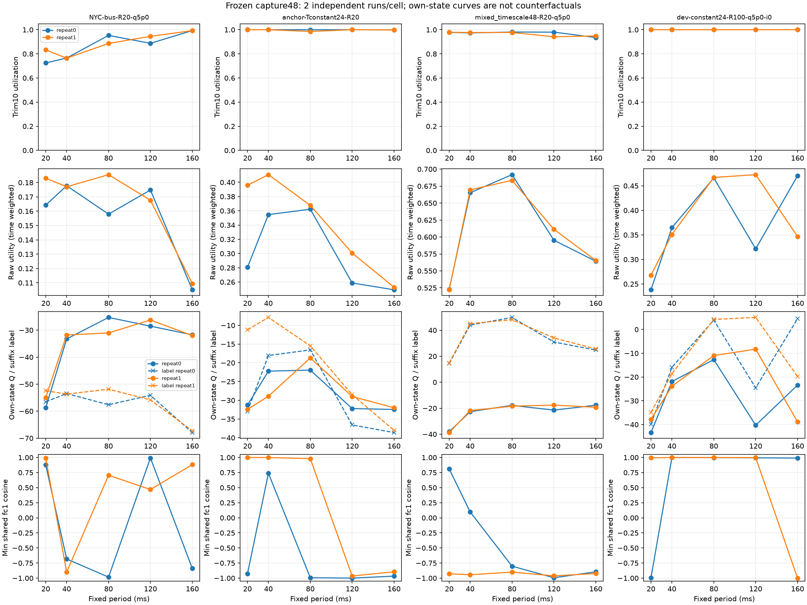

# 48 次冻结补采：采证完成，原 A 解释保持降级边界

48/48 次 60 秒连接完成，0 网络失败、0 优化器操作。采得 63,156 个完整 149 维状态/动作/后继区间及 15 个原始字段。原 FAIL_A 不改判，D-Q、B0/C、新训练和 λ 扫描均未执行。

用户批准原38次加10次；实际24格×2次，新增anchor/R20和mixed-timescale/R20的A80，以及constant24/R100的A80/A120/A160。四个条件因此具有20/40/80/120/160ms完整扫描，另外两个仅20/40ms。条件按原host和重复配对，60秒运行长度不变。

## 插桩容差：先登记，逐格降级

利用率差≤3个百分点，mean queue差≤max(2ms,原值20%)，P95差≤max(3ms,原值20%)；full、0—10秒和trim10全部逐重复核对。48个run中24个全过；24格中8格两次全过，16格降级。432项核对有121项超差。详见逐项CSV与cell-summary.csv。

超差不能分辨是插桩影响还是重新建连的自然变化。对应格只用于描述本轮新轨迹，不能直接解释旧A失败轨迹；不通过合并平均、放宽容差或追加重复挽救。完整状态只在RAM保留、原生停止后写NPZ，没有加入TCP中的额外神经网络查询。

## 奖励、边界与局部梯度

逐区间复算原reward v1效用与部署记录的最大绝对误差为0；原始reward和K中心化reward分别保留，没有替换为包均值代理。actor实际逐状态前向核对最大差0，未放宽1e-6容差。

全部新连接未观察到float32精确±1饱和，最高abs(a)>.99占比为97.57%。因此整数25%动作或边界集中不能直接解释为tanh精确死亡。每run预登记32个均匀点及前4次边界跨越相邻点，逐点记录z、局部导数、Q1/Qmean动作梯度和正则分量。没有精确饱和也不意味着动作正确，Q导数仍是critic的判断。

部署状态上的16点固定cohort跨周期查询，fc1有21/48个run、fc2有21/48个run出现负梯度余弦，最低分别-0.9999、-1.0000。这与D0训练状态样本上的正方向结果不同，说明不能外推训练状态上的一致性到部署状态。各周期RL/正则范数、逐层余弦均保留；不能仅据period_w因编码符号产生的负方向判冲突。

这些是冻结critic驱动的离策略跨周期查询，含启动/steady混合16点的批平均；不是真实环境梯度或历史训练损失的总体估计。共享trunk已有反向案例，当前证据不足以直接决定“仅每周期分一个末层头”能解决。BN反事实batch路径差异只说明敏感性；实际部署前向已核对，不判BN接线错误。

## Q 的周期偏好与有限回报

每run固定物理0、5、…35秒起点，得到384个H≥20秒同连接后缀标签；按run聚合，每格仍只有2条独立连接。Q标签用真实中心化回报加原冻结mean(Q1,Q2)尾项，N同理；没有训练或校准。run均值的“标签−预测”范围-36.18至108.93，既有高估也有低估，不能用一个统一偏差概括所有条件/周期。

最大折扣Q尾项绝对值0.9721，最大折扣twin半差0.0592；幅度与twin差都不是未知尾项误差的上界。重叠后缀不增加独立样本数，不据此生成虚假的窄置信区间。

四个完整扫描条件的实际效用、当前Q预测和同策略标签绘在图中。另保留每run同一16状态上五周期的Qmean argmax计数；其偏好随条件/状态变化，不是固定总偏向某个周期，也不等于选择器收益。各周期自己的轨迹不是同状态反事实真值，启动状态SHA也逐run保留；不以固定策略扫描宣布动态selector可行或不可行。

## 工程核验与下一项选择

模型所有变量（含BN/target/优化器槽）前后摘要一致；native动作映射、连续状态ID、同连接s1→s0、原生计时/ACK/loss字段另表核对。所有NPZ、原始逐包/计时日志仍在云端，本机仅有小JSON/CSV、代码、图和哈希，不下载checkpoint/replay。五机模型/51保护文件/源码/系统参数和归属进程/IPC最终核查见cleanup.json。

优先候选仍是另行审批D-Q，以固定数据和明确预算检验价值估计能否改善；当前结果不足以直接换头、加正则、改采样或长训。D0短周期采样权重结论不变。CPU仍沿用D0模型微基准；约90ms的CPU交点只是线性实现投影，本轮未做selector闭环CPU验证。

分析辅助错误均保留：首次批量矩阵路径出现1.788e-6前向差，改成部署单状态路径并保持1e-6容差；随后NumPy索引JSON序列化失败，仅修输出类型。只重算已采数据，未重跑任何TCP，未改采样/科学阈值。analysis-v1/v2及两次错误记录、修订SHA都保留。

文件：registration.json（采前登记）、captured-run-metrics.json（原始小指标）、analysis-results.json（只读诊断）、run-summary.csv、cell-summary.csv、instrumentation-checks.csv、state-point-diagnostics.csv、finite-return-labels.csv。两次重复逐项保留，不只给平均。

预算：首次准备连接至五机终检21.61分钟，保守连续五机占用1.801机时，分别低于45分钟/4机时。17:54:27起保留最后10分钟收尾；实例未自动关机，任务机时不等于云商账单。

## 两次重复的周期扫描明细

每项以“重复0 / 重复1”给出；Q差为同策略有限标签减当前预测。降级仅限制转用到旧A，数据不删除。

| 条件 | 周期ms | trim利用率% | mean queue ms | 平均效用 | Q差 | 旧A可转用 |
|---|---:|---:|---:|---:|---:|---|
| V17-NYC-bus-R20-q5p0 | 20 | 72.45 / 83.32 | 9.02 / 10.15 | 0.16 / 0.18 | 2.18 / 2.55 | 降级 |
| V17-NYC-bus-R20-q5p0 | 40 | 76.53 / 76.42 | 8.72 / 8.80 | 0.18 / 0.18 | -20.21 / -21.89 | 容差内 |
| V17-NYC-bus-R20-q5p0 | 80 | 95.31 / 88.62 | 25.20 / 13.42 | 0.16 / 0.19 | -32.31 / -20.83 | 降级 |
| V17-NYC-bus-R20-q5p0 | 120 | 88.73 / 94.50 | 15.90 / 21.33 | 0.17 / 0.17 | -25.59 / -29.56 | 降级 |
| V17-NYC-bus-R20-q5p0 | 160 | 99.30 / 99.26 | 52.07 / 49.32 | 0.11 / 0.11 | -36.18 / -35.27 | 降级 |
| V17-anchor-Tconstant24-R20 | 20 | 100.00 / 100.00 | 24.31 / 10.26 | 0.28 / 0.40 | -1.64 / 21.26 | 降级 |
| V17-anchor-Tconstant24-R20 | 40 | 100.00 / 100.00 | 15.19 / 9.07 | 0.35 / 0.41 | 4.18 / 21.03 | 降级 |
| V17-anchor-Tconstant24-R20 | 80 | 99.96 / 98.57 | 15.17 / 14.07 | 0.36 / 0.37 | 5.40 / 3.23 | 容差内 |
| V17-anchor-Tconstant24-R20 | 120 | 100.00 / 100.00 | 29.17 / 22.07 | 0.26 / 0.30 | -4.37 / 0.49 | 容差内 |
| V17-anchor-Tconstant24-R20 | 160 | 99.89 / 99.85 | 32.04 / 31.49 | 0.25 / 0.25 | -6.18 / -6.04 | 容差内 |
| V17-compound_drop24-R100-q5p0 | 20 | 99.63 / 99.77 | 147.19 / 134.89 | 0.23 / 0.23 | 26.35 / 26.37 | 降级 |
| V17-compound_drop24-R100-q5p0 | 40 | 98.82 / 98.45 | 108.36 / 64.18 | 0.27 / 0.33 | 29.23 / 24.73 | 降级 |
| V17-mixed_timescale48-R20-q5p0 | 20 | 97.81 / 97.90 | 20.96 / 21.22 | 0.52 / 0.52 | 52.53 / 53.66 | 降级 |
| V17-mixed_timescale48-R20-q5p0 | 40 | 97.36 / 97.65 | 12.03 / 11.87 | 0.67 / 0.67 | 66.67 / 66.89 | 降级 |
| V17-mixed_timescale48-R20-q5p0 | 80 | 98.10 / 97.75 | 11.51 / 11.94 | 0.69 / 0.68 | 67.65 / 66.56 | 容差内 |
| V17-mixed_timescale48-R20-q5p0 | 120 | 98.00 / 94.16 | 17.78 / 15.24 | 0.60 / 0.61 | 52.37 / 51.68 | 容差内 |
| V17-mixed_timescale48-R20-q5p0 | 160 | 93.54 / 94.87 | 19.03 / 19.16 | 0.56 / 0.57 | 42.45 / 44.87 | 降级 |
| V34-development-constant24-R100-q5p0-i0 | 20 | 100.00 / 100.00 | 159.23 / 126.67 | 0.24 / 0.27 | 3.61 / 2.88 | 降级 |
| V34-development-constant24-R100-q5p0-i0 | 40 | 100.00 / 100.00 | 68.29 / 75.67 | 0.36 / 0.35 | 5.99 / 5.31 | 容差内 |
| V34-development-constant24-R100-q5p0-i0 | 80 | 100.00 / 100.00 | 28.94 / 28.78 | 0.47 / 0.47 | 16.62 / 15.19 | 降级 |
| V34-development-constant24-R100-q5p0-i0 | 120 | 100.00 / 100.00 | 90.13 / 25.32 | 0.32 / 0.47 | 15.72 / 13.35 | 降级 |
| V34-development-constant24-R100-q5p0-i0 | 160 | 100.00 / 100.00 | 25.68 / 74.70 | 0.47 / 0.35 | 27.95 / 19.09 | 降级 |
| V34-development-mixed_pulse48-R100-q5p0-i0 | 20 | 99.57 / 98.96 | 117.69 / 64.88 | 0.53 / 0.70 | 87.85 / 98.72 | 降级 |
| V34-development-mixed_pulse48-R100-q5p0-i0 | 40 | 98.18 / 98.28 | 31.45 / 33.64 | 0.84 / 0.83 | 107.50 / 108.93 | 容差内 |

48个启动状态SHA全部不同，没有确认任何跨run同初始149维状态；不把启动时刻当成精确匹配反事实。

